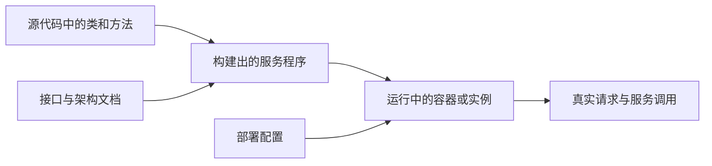

# 从零理解成熟度评估项目

这个项目要做的是：同时查看一个软件系统的代码和实际运行状态，找出影响质量的问题，说明判断依据，再尝试修改并验证修改效果。当前阶段先把已有工具跑起来，建立以后比较新方法的基线。

你的 motivation、challenge 和方案保存在 [原始项目要求](原始项目要求.md)，没有改动。下面仅解释其中的概念和执行顺序。

## 成熟度到底在评估什么

一个系统“能启动”“功能正常”和“成熟”是不同程度的判断。以购物系统为例，正常情况下能下单，只能说明某条功能路径可用。支付服务变慢时是否超时、重试会不会重复扣款、配置是否暴露数据库、修改一个模块会不会牵连很多服务，都需要其他证据。

本项目中的成熟度可以理解为：一个系统在明确的质量要求下，具备多大程度的可维护、可靠运行和持续改进能力。必须先规定评估维度、指标、适用条件和判断规则，才谈得上得分或等级。

| 层次 | 含义 | 例子 |
| --- | --- | --- |
| 评估维度 | 关心哪一种能力 | 可维护性、可靠性、安全性、可观测性 |
| 指标 | 用什么量或事实描述它 | 重复代码比例、请求失败率、是否有超时 |
| 证据 | 指标从哪里来 | 文件与行号、实际配置、某次故障实验的调用链 |
| 判断规则 | 什么条件算通过 | 下游不可用时，入口请求在规定时间内返回降级结果 |
| 结论 | 在这些证据下能说什么 | 本次指定故障下满足该条要求 |

不要直接把“代码告警少”当成“系统成熟”。没有覆盖到的能力应记录为未评估，而不是默认通过。代码异味数量、故障测试通过率和云资源配置风险也没有天然可相加的单位。

组织过程成熟度是另一个相关概念。CMMI 主要用于组织能力和过程改进，其评价需要相应的实践与评估过程；扫描一个代码仓库不能替代 CMMI 评估。本项目当前关注软件及其运行系统的技术证据。[ISACA 的 CMMI 介绍](https://www.isaca.org/resources/reference-guide/cmmi-model-quick-reference-guide)

## 代码 架构和部署是什么关系

**源代码**是开发者编写的程序文本。方法实现一段操作，类组织相关数据和方法，模块把一组功能组织起来。

**服务**是可以通过接口访问的运行单元。例如订单服务调用支付服务。一个服务可以包含很多类，也可以同时启动多个副本。代码中的一个类不能直接当成一个服务。

**接口 API**约定如何发起调用、需要什么参数、返回什么结果。例如 `POST /orders` 接收商品与数量，返回订单编号。接口文档描述预期契约，实际响应提供运行证据，两者可能不一致。

**架构**描述组件如何分工、相互依赖及其约束。例如订单依赖支付和库存，数据写入哪个数据库。架构信息既可以来自文档和代码，也可以来自实际调用。

**部署**说明软件具体运行在哪里、怎样运行，包括容器、主机、实例数量、端口、环境变量和网络连接。部署配置文件描述期望状态，运行时查询才说明当前实际状态。

**Docker 容器**用于把程序及其依赖放在相对隔离的环境中运行。本次部署侧实验使用本机 Docker 中真实启动的服务，实际发送 HTTP 请求并注入故障，不用虚构的部署 JSON 代替运行系统。



## 白盒 黑盒 静态和动态分析

这几组词描述的角度不完全相同。

| 概念 | 通俗解释 | 本项目中的例子 |
| --- | --- | --- |
| 白盒分析 | 可以查看程序内部结构 | 阅读 Java 方法，分析方法与类的依赖 |
| 黑盒分析 | 通过外部接口观察行为 | 发送请求，检查返回值与响应时间 |
| 静态分析 | 不运行待测业务程序，分析代码或其他材料 | 检查可疑写法、依赖关系和代码复杂度 |
| 动态分析 | 运行程序，再观察行为 | 对正在运行的服务注入 HTTP 错误 |
| 灰盒分析 | 除外部行为外，还利用部分内部或运行信息 | 利用调用链定位请求，再从代理注入故障 |

在保留原方案用语的前提下，实验表用“是否读取待测源码”和“是否读取实际运行信息”划分输入，更容易复核。Reynard 不读取业务源码来做静态诊断，但需要代理、追踪上下文和测试请求，因此不能描述成完全没有接入条件的黑盒工具。

Java 静态分析有时会读取源码和由同一源码生成的 `.class` 文件，以获得类型信息。本轮 AppCAT 使用 source-only 模式，输入为 Java 源文件和 Maven 工程描述；业务契约另行编译执行。

## 代码异味 技术债和重构

**代码异味**是可能增加理解和维护成本的代码特征，例如重复逻辑、过长的方法或不合理的职责归属。它可能暂时不引起功能错误，需要结合上下文判断。

**Feature Envy**常译为“依恋情结”：某个方法与别的类的数据和行为联系过多，可能更适合放进那个类。例如订单类中的一个方法主要读取地址对象并格式化地址，工具可能建议把方法移到地址类。是否真应迁移，还要检查业务职责、可见性和公共接口。

**耦合**描述组件之间的联系。一个方法频繁访问另一个类，会增加两者的联系。**内聚**描述同一组件内部的职责是否集中。feTruth 从源码提取方法、类名和耦合特征，再推荐可能的 `Move Method`，即移动方法重构。[feTruth 作者仓库](https://github.com/lyoubo/feTruth)

**重构**是在保持外部行为的前提下调整内部结构。生成移动建议不等于完成重构；真正改动后，还需要编译、测试和接口检查。

**技术债**指未来修改和维护需要付出的代价。工具输出的修复工作量是估计值，不是已经花费的时间，也不能保证实际开发工时。应该结合具体问题、依赖关系和回归验证解释。

## 可观测性和知识图谱

可观测性让人从系统输出的信息推断运行状态。常见数据有三类：**指标**记录数值，例如错误率；**日志**记录事件，例如支付失败；**调用链 trace**把一次请求经过的多个服务连接起来。调用链中的一段操作称为 **span**。

知识图谱用节点表示对象，用边表示关系。例如：

```text
OrderService.java --实现--> order-service
order-service --运行于--> order-container-1
order-service --调用--> payment-service
某条代码告警 --定位于--> OrderService.java:80
某次故障实验 --影响--> order-service 的下单接口
```

这样才能回答“这个代码问题对应哪个线上服务”“某个服务失败可能影响谁”。静态分析发现的是可能的调用，实际 trace 记录的是特定请求确实发生的调用；两者必须保留来源，不能混成同一种证据。

UModel 的全称是 Universal Observability Model，是阿里云以图结构统一描述可观测对象及关系的方法。它组织实体、关系和相关数据，并不自动给系统成熟度打分。原方案中“类似于 UModel”的作用，是建立代码、服务、部署和运行证据之间的联系。[UModel 官方说明](https://www.alibabacloud.com/help/zh/cms/cloudmonitor-2-0/overview/)

同一服务的开发分支不一定就是当前部署版本，因此关联时还需要提交编号、构建版本或镜像摘要。只有名称相同，不足以断言源码与部署一致。

## 测试注入 故障注入和混沌工程

**测试注入**在这里可理解为让 Agent 生成并执行针对性测试，例如补充一个超时场景的接口测试。测试必须写清输入和预期结果。

**故障注入**是主动制造受控异常，例如让一次服务调用返回 503，或使网络延迟增大，再观察系统反应。**混沌工程**是在明确假设、观测指标和影响范围下系统地做这类实验。ChaosBlade 是可以执行多种故障的工具，负责“让故障发生”；它本身不能代替成熟度指标和判断规则。[ChaosBlade 官方说明](https://chaosblade.io/en/docs/)

**超时**限制一次等待的时长；**重试**是在失败后再次尝试；**降级**是在部分能力不可用时提供有限结果；**熔断**是在连续失败时暂时停止继续请求；**幂等**要求同一操作重复执行不会产生额外业务副作用。是否使用这些机制，要看接口语义，而不是机制越多越成熟。

实验需要 **oracle**，即判断结果对错的规则。例如“同一订单最多扣款一次”。如果只检查程序有没有崩溃，就不能判断有没有重复扣款。Reynard 本次一个场景检查预期 HTTP 状态，另一个场景主要检查实际注入的故障是否与请求的故障一致；它们各自能支持的结论不同。

**故障空间**是可能故障位置和故障模式的组合。多个调用各有多种故障时，组合数会快速增长。**搜索约简**利用已经观察到的依赖或行为跳过部分组合，从而减少实验次数。约简后的测试数量不是系统健康分数。

## Agent 子 Agent和工作树

Agent 可以理解为一个会根据目标选择下一步操作的程序：读取信息、提出假设、调用工具、检查结果，再决定下一步。它与一次普通问答的区别在于能持续操作外部工具。它的推断仍然需要文件、配置或实验结果支撑。

子 Agent 用于拆分任务。原方案先估计修改影响范围，再安排并行修改，是为了减少相互干扰。例如修改一个公共接口会影响多个调用方，应把这些改动视为有依赖的任务。

Git 工作树 worktree 是同一仓库的另一个检出目录，通常配合独立分支使用，让不同修改在不同文件目录中进行。有依赖的 Agent 共用工作树时，仍需要明确文件修改责任和执行顺序，否则两个 Agent 同时修改同一文件会互相覆盖。

**二次复审**除了看代码，还要对照原问题检查：原来的失败是否消失、相关功能是否回归、修改是否引入新的依赖问题。只看到测试变绿，不能排除测试断言被删掉或预期被放宽。

## 当前阶段怎么做

**Baseline**就是比较基准。以后提出新方法时，需要在相同输入、任务和资源约束下，与已有方法比较，才能知道提升来自哪里。

最新学术基线为 Infer/Pulse 与 feTruth：前者诊断源码中的程序错误，后者给出 Java 方法职责和移动建议，两者不需要业务断言。商用 AppCAT 分析云迁移问题，NeuVector 读取真实部署风险。论文重放、新源码结果与实际部署实验分别报告，不合成为统一成熟度分数。详见[图文报告](成熟度评估baseline调研结果.md)和[完整输入输出清单](基线输入输出清单.md)。

后续落实原方案时，先选一个同时有源码和本地部署的系统，跑通“对象关联 → 提出一个问题 → 验证问题 → 修改 → 再验证”的完整链路，再扩大指标和并行任务。验收时可以分别比较源码单独分析、部署单独分析、两者联合分析，以及加入 Agent 主动探测后的增量。这样能检验原方案中的两个 challenge，而不会用一个未经验证的总分掩盖差异。

原方案可以按下面的顺序落实；这只是执行拆解，不替换原文。

| 阶段 | 具体工作 | 可验收的产物 |
| --- | --- | --- |
| 基线阶段 | 运行现有源码与部署侧方法 | 本次的版本清单、日志、结果和报告 |
| 对象关联 | 在同一个 Java 微服务系统上关联方法、接口、服务和容器，并记录版本 | 能从某条源码告警查到对应部署实例，也能从 trace 查回相关代码 |
| 主动验证 | 为一条明确要求生成测试或故障实验，记录注入点、前后观测和恢复结果 | 一个可以重复触发的问题，配套判断规则和原始证据 |
| 修改验证 | 按依赖范围分派修改，合并后重放原实验与相关回归 | 原问题解决，接口行为与其他相关功能仍满足要求 |

选同一个 Java 系统，是因为当前两个源码基线都以 Java 作为实验对象。这样可以直接复用已经跑通的工具，不把语言适配与诊断能力提升混在一起。第一条联合问题可选“代码中的请求等待逻辑与实际超时配置共同导致入口请求迟迟不返回”，但它只是后续实验设计示例，本次尚未发现该缺陷。

## 怎样判断评估工具本身是否有效

**真值 ground truth**是经过独立确认的问题集合。工具说有问题，不等于已经得到真值。可以通过专家复核、能够复现的失败或经过审查的缺陷变体建立真值。

**精确率 precision**回答“报出来的问题有多少是真的”；**召回率 recall**回答“已知真实问题有多少被找到”。若正确报出的数量为 TP、误报为 FP、漏报为 FN，则精确率为 `TP/(TP+FP)`，召回率为 `TP/(TP+FN)`。F1 是两者的调和平均值。没有真值时，只能统计告警数量，不能计算有意义的准确性结论。

**消融实验 ablation**是有控制地移除某个组成部分再比较结果。例如关闭源码输入，观察哪些已经确认的问题不再被发现。只有待测系统、输入版本和实验预算相同，才能把差异归因于被移除的部分。

同样，**修复成功率**的分母应是实际尝试修复的已确认问题，成功需要通过既定验收；不能把“Agent 给出一段建议”计作已修复。**影响范围**应同时记录修改了哪些文件、哪些接口及可能受影响的服务。图中的依赖关系用于估计范围，最后仍需要相关测试验证。
