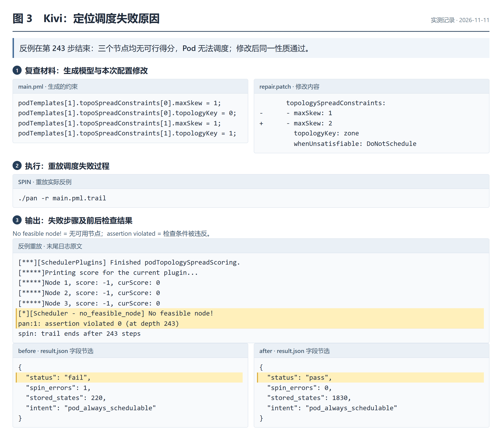
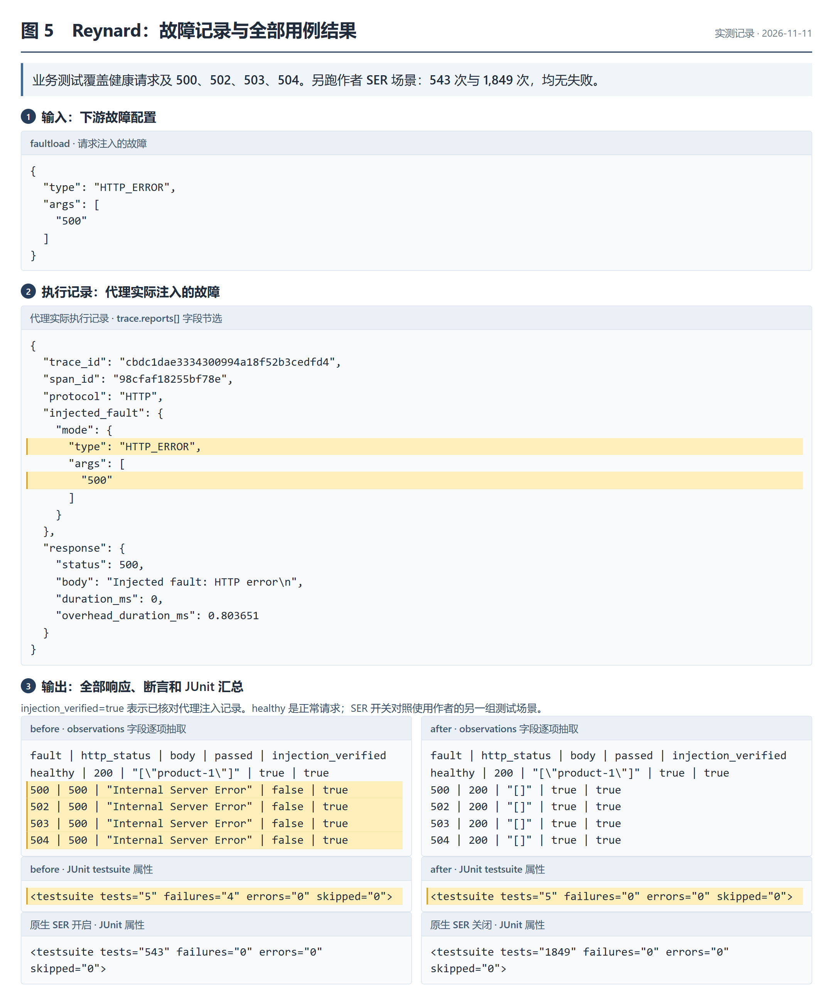
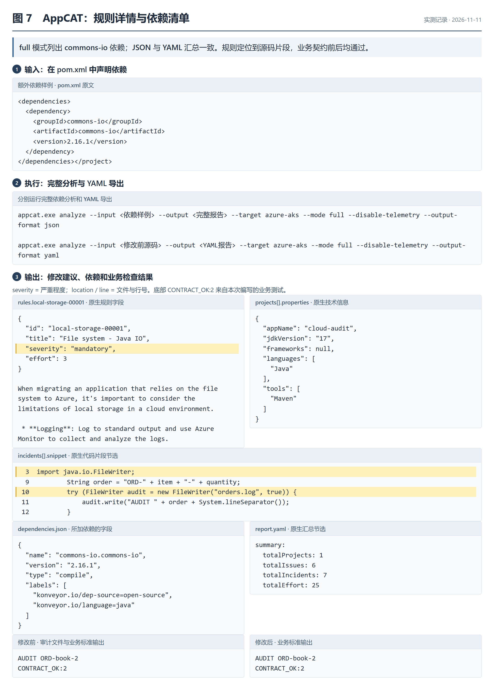
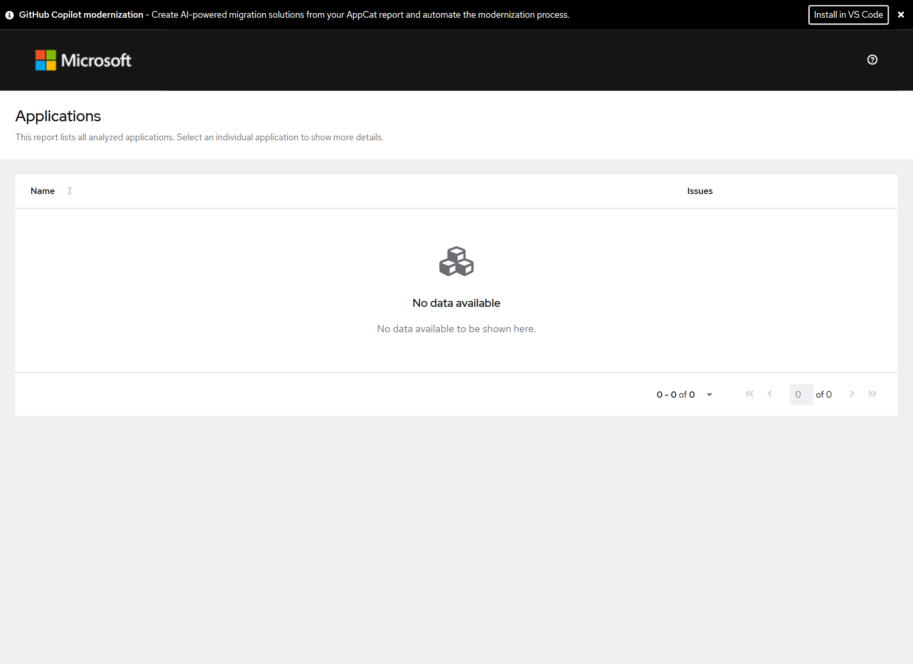
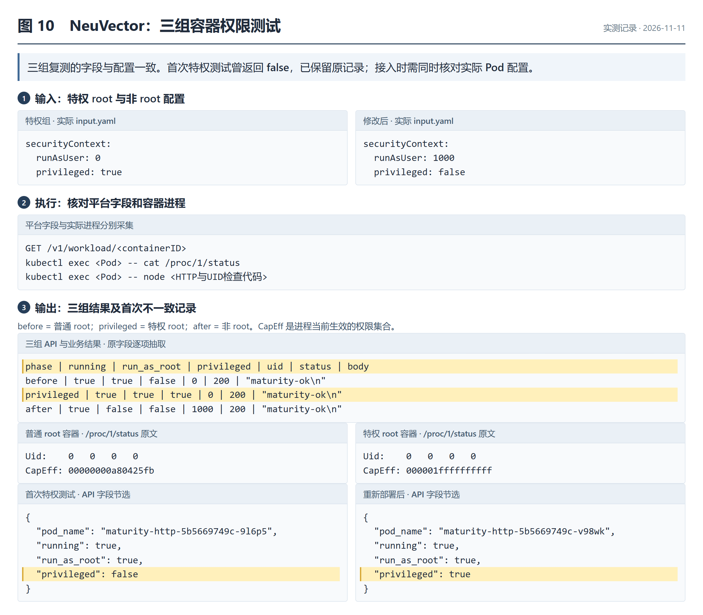
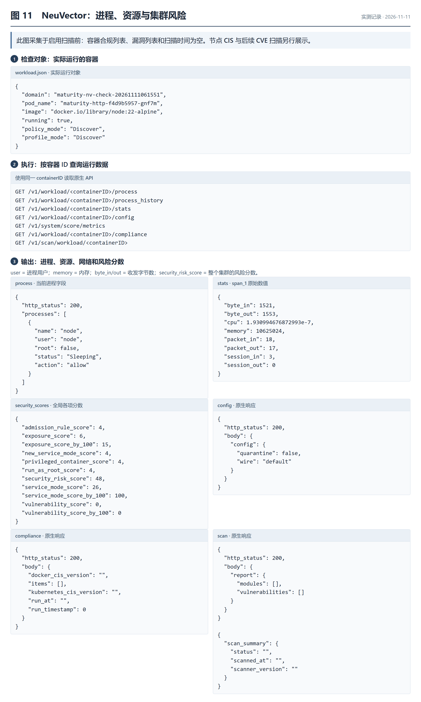
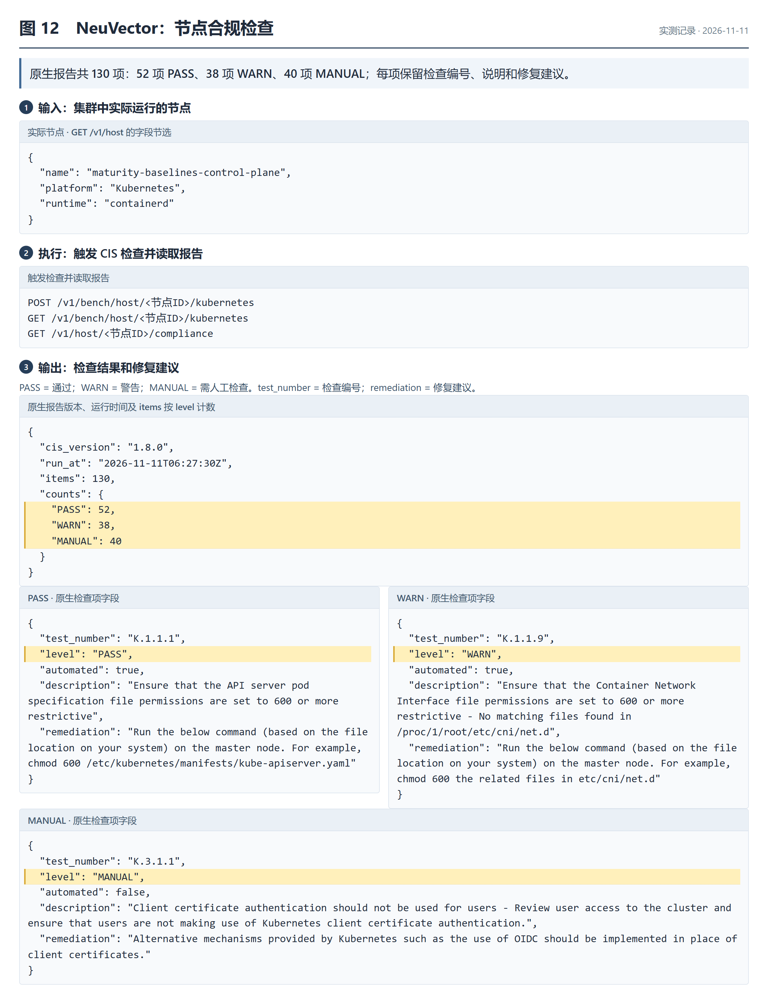
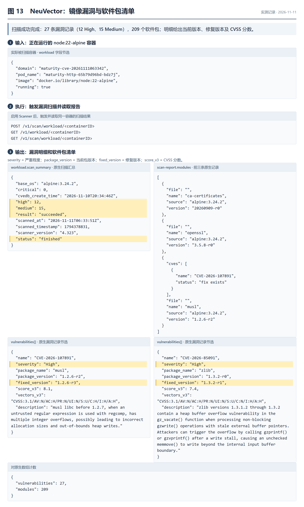
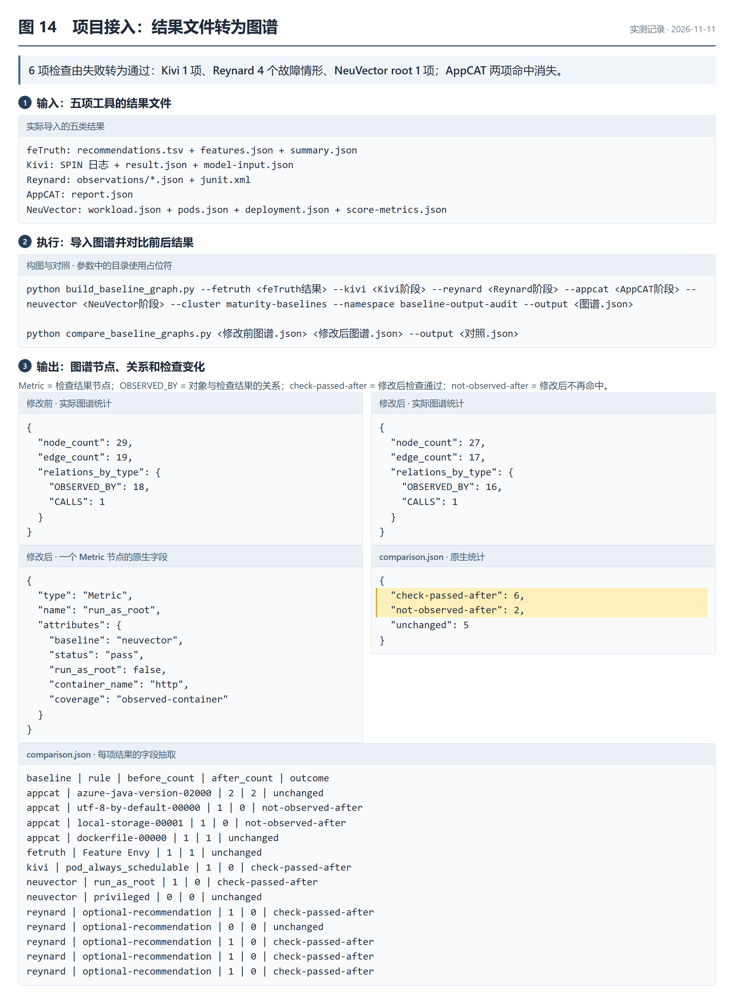

# 成熟度评估 baseline 调研结果

文档更新：2026-11-13；实测日期：2026-11-11。

## 1 输入输出总览

| 方案 | 输入什么 | 输出什么 | 本次测试结果 |
| --- | --- | --- | --- |
| feTruth | Java 工程源码，包含待检查的方法及相关类 | 方法重构建议：哪个方法建议移到哪个类；附候选类、调用耦合特征和数量统计 | 建议将 `OrderService.createOrder` 移到 `PaymentService`，共 1 条建议 |
| Kivi | Deployment、HPA 配置，节点与 Pod 分布，以及待检查的调度条件 | 调度检查是否通过；失败时给出触发问题的执行步骤；附生成模型和搜索统计 | 扩到 6 个 Pod 时无法调度；调整 zone 的 `maxSkew` 后检查通过 |
| Reynard | 已启动的微服务、HTTP 测试请求、下游故障配置、预期业务响应 | 实际注入的故障、调用链、HTTP 响应、断言结果和 JUnit 测试报告 | 下游 4 种错误均导致入口返回 500；增加降级后，入口均返回 `200 + []` |
| Microsoft AppCAT for Java | Java 源码、`pom.xml`，以及目标平台参数 `azure-aks` | 云迁移问题清单：文件、行号、代码片段、严重程度、修改建议和工作量；附技术栈、依赖清单 | 文件写日志改为标准输出后，命中次数从 7 降到 5 |
| SUSE Security／NeuVector | Kubernetes 集群中实际运行的节点、Pod、容器；在集群内部署采集组件 | 容器权限风险、进程和资源数据、节点合规检查、镜像漏洞、软件包清单、风险分数 | 完成 3 组权限测试；节点合规 130 项；镜像漏洞 27 条；软件包 209 项 |

feTruth、AppCAT 用于源码检查；NeuVector 用于部署检查；Kivi 检查调度配置，Reynard 检查故障下的服务响应。单次检查只需提供当前输入；文中的“修改前、修改后”是为验证改动效果分别执行的两次检查。

## 2 来源与部署准备

| 方案 | 来源 | 运行环境 |
| --- | --- | --- |
| feTruth | ESEC/FSE 2023；作者仓库 lyoubo/feTruth，1 star | JDK 17；Python 3.6 容器，TensorFlow 2.4.0、Keras 2.4.3；作者模型及词向量 |
| Kivi | USENIX ATC 2024；作者仓库 bingzheliu/Kivi，23 stars | Linux 容器，Kivi、SPIN、GCC |
| Reynard | ICSE 2026 Research Track；作者仓库 reynard-testing/reynard，4 stars | JDK 17、Maven、Docker；Controller、Proxy 和被测服务 |
| AppCAT | 微软 Azure Migrate 官方 Java 评估工具，免费使用 | 官方 CLI 7.7.0.11、JDK 17 |
| NeuVector | SUSE 容器安全产品；本次使用 NeuVector 开源发行版 | Kubernetes、Helm；Controller、Enforcer、Manager 5.6.4；漏洞检查另启用 Scanner |

Star 数采集于 2026-10-29。项目侧在 Python 虚拟环境中安装 maturity-evaluate 及依赖，用读取器将工具结果转换为项目图谱。本次 Kubernetes 测试环境为单节点 kind 集群。

## 3 各方案的输入、执行和输出

截图中的源码、配置和结果取自实测记录，黄色标出关键字段。命令中的尖括号表示需替换的参数。图 8 为 AppCAT 自带页面，其余为运行记录的排版截图。

### 3.1 feTruth：检查方法是否放在合适的类中

输入：Java 工程源码目录。本次检查 `OrderService.createOrder`，同时提供它调用的 `InventoryService`、`PaymentService` 等相关类。

执行：用 `testingDataGeneration.jar` 提取候选方法和类之间的特征，再执行 `python feTruth.py -a <源码目录>`。工具结合方法、类的名称和调用关系，生成方法移动建议。

| 结果文件 | 输出内容 | 本次结果 |
| --- | --- | --- |
| `recommendations.tsv` | 重构类型、原方法签名、建议迁入的类 | `Move Method`：`OrderService.createOrder` → `PaymentService` |
| `features.json` | 源类、方法、候选目标类；方法与各类的距离及调用耦合特征 | 1 个候选方法，对应 `InventoryService`、`PaymentService` 两个候选类 |
| `summary.json` | 采集脚本统计的候选方法数、候选组合数、建议数 | `candidate_methods=1`、`candidate_pairs=2`、`recommendations=1` |

图 1 上方是被检查的方法，下方 `Source Method` 是原方法，`Target Class` 是建议迁入的类。本次得到 1 条重构建议，尚未执行方法移动。

### 3.2 Kivi：检查扩容后能否正常调度

输入：`deploy.yaml`、`autoscaler.yaml`、描述节点与 Pod 分布的 `cluster_configs.json`，以及指定检查条件的 `intents.json`。本次模型有 3 个节点、2 个 zone，Pod 从 5 个扩到 6 个，检查条件为 `pod_always_schedulable`（Pod 始终可调度）。

执行：Kivi 将配置转成 Promela 模型，由 SPIN 搜索调度和扩容过程，查找违反检查条件的执行步骤。本次手工将 zone 的 `maxSkew` 从 1 改为 2，再使用相同条件检查。

| 结果 | 输出内容 | 本次结果 |
| --- | --- | --- |
| 检查结果 `result.json` | `status` 为通过或失败；`spin_errors` 为反例数 | 修改前 `fail / 1`；修改后 `pass / 0` |
| 反例日志 | 导致调度失败的动作、节点状态和失败位置 | 第 243 步出现 `No feasible node!` |
| 搜索统计 | `stored_states`：搜索保存的状态数 | 修改前 220，修改后 1,830 |
| 生成模型 | `main.pml`、`config.pml`、`event.pml`、`intentsCheck.pml` | 用于重放调度过程和定位失败条件 |

图 2 左上 `maxSkew=1` 对应左下 `errors: 1`；右上改为 2 后，右下为 `errors: 0`。这里的 `maxSkew` 限制不同 zone 之间允许的 Pod 数量差。

图 3 展示修改的配置和失败步骤：三个节点都无法接收待调度 Pod。配置差异由本次修改生成，Kivi 负责验证修改后的模型。

### 3.3 Reynard：检查下游故障时服务能否正常降级

输入：已启动的 `frontend`、`recommendations` 服务，以及 Java 测试代码。测试代码包含入口 HTTP 请求、下游故障配置和预期响应：正常时返回 `200 + ["product-1"]`；下游故障时返回 `200 + []`。

执行：启动 Controller 和 Proxy，通过 Maven 执行测试。Proxy 拦截下游调用，分别注入 HTTP 500、502、503、504；测试代码检查入口响应。增加空列表降级后，再执行同一组用例。

| 结果文件 | 输出内容 | 本次结果 |
| --- | --- | --- |
| `observations/*.json` | 服务、下游依赖、注入故障、调用链、HTTP 状态码、响应体、断言结果 | 修改前 4 个故障用例均返回 500；修改后均返回 `200 + []` |
| 记录中的 `trace.reports` | `trace_id`、`span_id`、`injected_fault`、代理实际响应 | 核对故障是否真正注入到了目标调用 |
| `junit.xml` | `tests`、`failures`、`errors`、`skipped` | 修改前为 5 / 4 / 0 / 0；修改后为 5 / 0 / 0 / 0 |

图 4 中的 `http_status` 是入口返回码，`body` 是响应内容，`passed` 是业务断言是否通过。下游返回 500 时，修改后的入口返回 200 和空列表。

图 5 列出全部 5 个用例及代理注入记录。另在作者测试场景中对比 SER（减少重复探索的策略）：开启时执行 543 次，关闭时执行 1,849 次，两组均通过。

### 3.4 AppCAT：检查 Java 应用迁移到 AKS 需要改什么

输入：包含 `pom.xml` 的 Java 源码目录，目标平台设为 `azure-aks`。本次代码用 `FileWriter` 将审计日志写到 `orders.log`。

执行：运行 `appcat analyze --input <源码目录> --output <报告目录> --target azure-aks --mode source-only --disable-telemetry --output-format json`。工具按 AKS 迁移规则检查代码和工程配置。本次将文件写日志改为标准输出，再扫描一次。

| 结果文件 | 输出内容 | 本次结果 |
| --- | --- | --- |
| `report.json` | 规则 ID、文件及行号、代码片段、严重程度、修改建议、工作量估计 | 本地存储与默认编码两项提示消失；剩余 Java 版本和 Dockerfile 提示 |
| 报告中的 `summary` | `totalIssues`：规则项数；`totalIncidents`：命中次数；`totalEffort`：工作量估计，非工时 | 规则项 6 → 4；命中次数 7 → 5；工作量估计 25 → 19；统计包含技术发现信息 |
| 报告中的 `properties` | 应用名称、JDK 版本、语言和构建工具 | cloud-audit、Java 17、Java、Maven |
| `dependencies.json` | 依赖名称、版本、作用域和分类；使用 `--mode full` 生成 | 识别到样例中添加的 commons-io 2.16.1，作用域为 compile |
| `report.yaml`、HTML 页面 | YAML 结构化报告及浏览器报告 | YAML 与 JSON 汇总一致；HTML 页面显示空列表 |

图 6 左上是修改前的文件写入代码，右上改为 `System.out.println`。左下 `local-storage-00001` 定位到 `CloudAudit.java`，级别为 `mandatory`（迁移必须处理）；修改后该项不再命中。

图 7 补充规则修改建议、源码片段、技术栈和依赖清单。底部 `CONTRACT_OK:2` 来自本次编写的业务检查，表示订单结果和非法数量处理均通过；审计文本也保持一致。

图 8 是本次生成的 HTML 页面，显示 `No data available`；本项目读取 `report.json` 中的扫描结果。

### 3.5 NeuVector：检查实际运行的容器和集群

输入：Kubernetes 集群访问权限，以及集群中已运行的节点、Pod 和容器。本次部署名为 `maturity-http` 的 HTTP 服务，镜像为 `node:22-alpine`，依次测试普通 root、特权 root、非 root 三种配置。

执行：通过 Helm 部署 Controller、Enforcer、Manager，登录平台后读取 API。Enforcer 采集容器运行状态；按节点 ID 执行 CIS 合规检查；启用 Scanner 后，按容器 ID 扫描软件包和漏洞。通过端口转发访问 Controller API，Updater 保持关闭。

| 检查内容 | 输入对象与操作 | 输出内容 |
| --- | --- | --- |
| 容器权限 | 对实际 `containerID` 查询 `/v1/workload/<ID>` | Pod 名称、容器 ID、`running`、`run_as_root`、`privileged` |
| 进程和资源 | 查询容器的 `process`、`process_history`、`stats`、`config` 接口 | 进程名、命令、用户；CPU、内存、流量、连接计数；策略模式及隔离状态 |
| 集群风险概览 | 查询 `/v1/system/score/metrics` | 全局风险分数及 root、特权、服务模式、暴露面等分项 |
| 节点合规 | 向 `/v1/bench/host/<ID>/kubernetes` 发起 POST，再 GET 报告 | 检查编号、PASS／WARN／MANUAL、问题说明、修复建议 |
| 镜像漏洞 | 向 `/v1/scan/workload/<ID>` 发起 POST，再 GET 报告 | CVE 编号、严重程度、受影响软件包、当前及修复版本、CVSS 分数、软件包清单 |

图 9 对比普通 root 和非 root：输入配置 `runAsUser` 从 0 改为 1000，API 返回的 `run_as_root` 从 true 变为 false。容器内另做 HTTP 检查，两次均返回 `200 + maturity-ok`。

图 10 列出三组权限测试。`privileged` 表示是否为特权容器，`uid` 是实测进程用户 ID。首次特权测试曾返回 `privileged=false`，重新部署后三组结果与配置一致，图中保留了两次记录。

图 11 展示进程、资源和网络数据。权限对照阶段三组全局风险分数均为 48；该分数统计整个集群。这张图采集于漏洞扫描前，所以漏洞列表和扫描时间为空。

图 12 是节点 CIS 1.8.0 检查报告：共 130 项，52 项通过（PASS）、38 项警告（WARN）、40 项需人工检查（MANUAL）。`test_number` 是检查编号，`remediation` 是修复建议。

图 13 是 `node:22-alpine` 容器的漏洞报告：扫描成功，返回 27 条漏洞记录，其中高危 12 条、中危 15 条，并列出 209 个软件包。以 musl 为例，报告中的当前版本为 `1.2.6-r2`，修复版本为 `1.2.6-r3`。

## 4 接入 maturity-evaluate

输入：上述工具生成的结果文件。读取器按类、服务、Deployment、Pod 和容器身份，将检查结果关联到对应对象。

输出：JSON 格式的项目图谱。对象和检查结果保存为节点；`OBSERVED_BY` 表示“对象有哪些检查结果”，`CALLS` 表示服务调用关系。图 14 中，`run_as_root` 检查节点的 `status=pass`、`run_as_root=false` 表示该容器的 root 检查通过。

| 来源 | 已接入内容 | 待完成 |
| --- | --- | --- |
| feTruth | 方法移动建议、候选特征及统计，关联类节点 | 评审并验证方法移动建议 |
| Kivi | 调度检查结果及反例，关联 Deployment 模型 | 从实际集群配置生成模型 |
| Reynard | 故障、调用关系、响应和断言，关联服务 | 接入团队 otel-demo 场景 |
| AppCAT | 规则命中、源码位置和统计，关联源码对象 | 扫描团队 Java 工程 |
| NeuVector | 容器身份、root／特权检查、风险分数 | 将已采集的 CIS、CVE、进程和资源明细加入读取器 |

本次合并结果：修改前 29 个节点、19 条边，修改后 27 个节点、17 条边。对照报告显示 6 项检查由失败转为通过、2 项命中消失、5 项不变。其中，6 项通过包含 Kivi 的 1 条条件、Reynard 的 4 个故障用例、NeuVector 的 root 检查；2 项消失来自 AppCAT 同一处日志代码修改。

