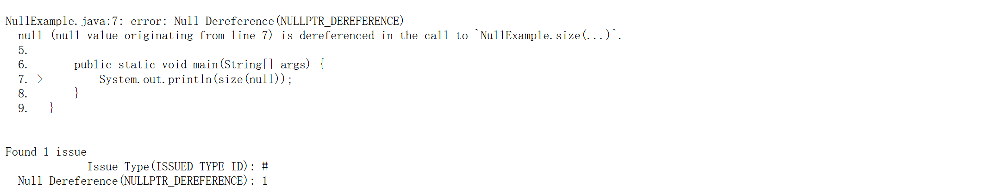
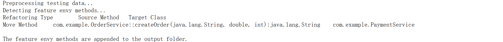
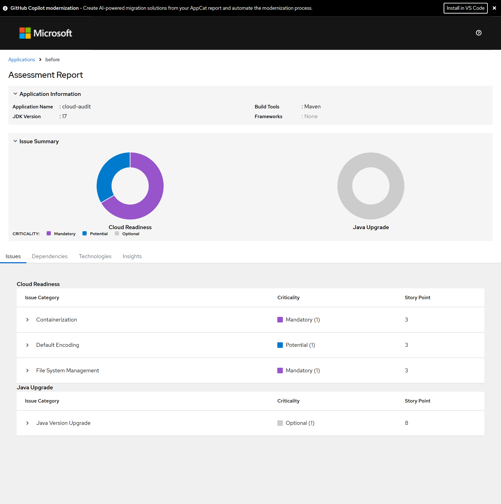
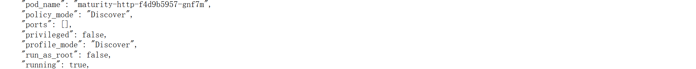
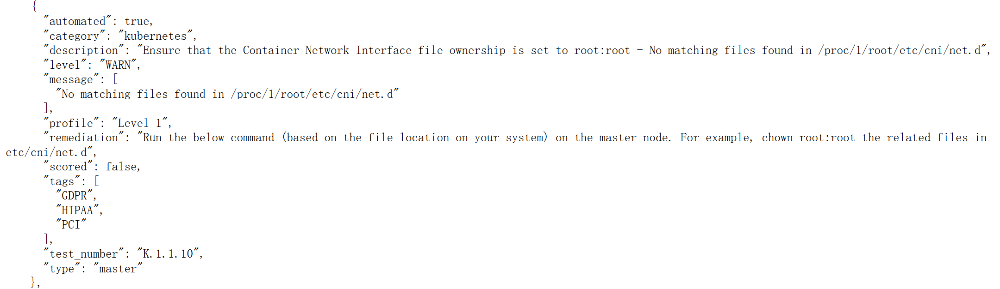
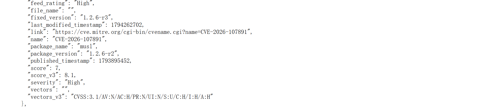

# 成熟度评估 baseline 调研结果

## 1. 选型与分工

学术基线采用 **Infer/Pulse + feTruth**，商用基线采用 **Microsoft AppCAT for Java + SUSE Security/NeuVector**，分别覆盖代码缺陷、代码设计、云迁移和运行安全。

| 类别 | 工具与版本 | 评估内容 | 输入 | 输出 |
| --- | --- | --- | --- | --- |
| 学术 | Infer 1.3.0 / Pulse；CAV 2020，CCF-A | 空指针、资源泄漏等代码缺陷 | 源码、编译依赖、构建命令 | 问题类型、代码位置、调用路径 |
| 学术 | feTruth；ESEC/FSE 2023，CCF-A | Java 方法职责划分 | Java 项目目录、预训练模型 | 方法移动建议：源方法 → 目标类 |
| 商用 | AppCAT 7.7.0.11 | Java 应用上云与版本升级 | 源码或应用二进制、目标平台 | 迁移问题、整改建议、技术栈和依赖清单 |
| 商用 | NeuVector 5.6.4 | 容器运行安全、合规与漏洞 | Kubernetes 集群、运行容器、节点、镜像 | 权限风险、运行事件、CIS 检查项、CVE 清单 |

四项工具均可复用内置检测能力。接入新项目时配置源码路径、构建环境、迁移目标或集群访问，无需编写业务规则。

## 2. Infer/Pulse：代码缺陷检测

### 输入与运行

| 输入项 | 具体内容 |
| --- | --- |
| 源码 | Java、C、C++、Objective-C、Hack 项目；Erlang、Rust 为实验性支持 |
| 构建环境 | 对应编译器、第三方依赖、classpath 或头文件搜索路径；Java 工程准备 JDK 和依赖 JAR |
| 分析入口 | 将正常构建命令交给 `infer run --pulse-only -- <构建命令>`；C/C++ 也可提供 `compile_commands.json` |
| 可选配置 | 结果目录、并行数、文件范围、告警过滤；已有捕获数据可分阶段执行 `analyze` 和 `report` |

Infer 在编译时捕获源码并生成中间表示。Pulse 沿调用路径跟踪变量、对象和资源状态，复用函数摘要开展跨函数分析，将触发问题的路径写入报告。

例如分析一个带外部依赖的 Java 文件：

```bash
infer run --pulse-only -- javac -cp dependency.jar -d classes Example.java
```

### 输出与使用

| 输出 | 具体内容与用途 |
| --- | --- |
| `infer-out/report.json` | 每条问题包含 `bug_type`（类型）、`severity`（级别）、`file/line/column`（代码位置）、`procedure`（所在方法）、`qualifier`（原因）、`bug_trace`（调用路径）；用于 CI 读取和问题列表展示 |
| `report.txt`、控制台输出 | 可直接阅读的问题描述与路径；供开发者定位代码 |
| 可选 HTML、差异报告 | `infer explore --html` 生成浏览器报告；`infer reportdiff` 比较新增、修复和已有问题；多个结果目录可合并去重 |
| 分析数据与日志 | `capture.db`、`results.db` 保存捕获与分析数据，日志记录编译、分析过程和异常 |

Infer 实际运行日志（2026-11-13）显示 `NullExample.java:7` 的空指针告警：



对应路径为：第 7 行传入 `null` → 调用 `size` → 第 2 行参数接收 → 第 3 行解引用。增加空值处理后，报告由 1 条变为 0 条。跨项目运行中，jsoup、Commons CLI、项目 Java 示例分别捕获 75、23、4 个 Java 文件，产生 6、0、0 条告警；jsoup 的类型为 `PULSE_RESOURCE_LEAK`。

## 3. feTruth：方法职责与重构建议

### 输入与运行

| 输入项 | 具体内容 |
| --- | --- |
| Java 工程 | 包含 `.java` 文件的项目目录；提取类、方法、方法调用和候选目标类 |
| 特征提取器 | `testingDataGeneration.jar`，通过 JDK 执行，将工程转换为方法与候选类的特征记录 |
| 模型文件 | `feTruth.h5`、Word2Vec 模型及配套数组文件；环境采用 Python 3.6、TensorFlow 2.4.0、Keras 2.4.3 |
| 已有特征入口 | 可使用预先提取的 JSON；论文归档 v1.0.0 提供配套特征与模型 |
| 可选训练入口 | 带标签的方法—目标类样本、名称和耦合特征，用于训练新的模型 |

在工具目录中先提取特征，再运行推理：

```bash
java -jar testingDataGeneration.jar /workspace/order-service
python feTruth.py -a /workspace/order-service
```

模型同时使用方法名、类名的词向量，以及方法与原类、候选类之间的距离和耦合指标。默认阈值为 0.95，为符合条件的方法选择得分最高的目标类，生成 Move Method 建议。

### 输出与使用

| 输出 | 具体内容与用途 |
| --- | --- |
| `output/<项目名>.txt`、控制台输出 | Tab 分隔的三列：`Refactoring Type`（重构类型）、`Source Method`（源方法完整签名）、`Target Class`（目标类）；用于生成重构任务 |
| `testing_data/<项目名>.json` | `RECORDS` 数组包含项目名、原类、方法名与签名、原类指标和候选类指标；用于追溯推荐依据 |
| 预处理文件 | `test_name.txt`、`test_dist.txt`、`test_cbmc.txt`、`test_mcmc.txt`，分别保存名称、距离与耦合特征 |
| 日志及训练产物 | 提取和推理日志；选择训练流程时输出模型与训练日志 |

特征中的 `source_dist/source_cbmc/source_mcmc` 对应原类，`target_class_list` 与 `target_dist_list/target_cbmc_list/target_mcmc_list` 按位置对应各候选类。

实际项目示例提取 1 个方法、2 个候选目标，生成 1 条建议。以下为原生推理日志（2026-11-11），包含预处理、检测过程及方法移动结果：



该建议表示将订单服务的 `createOrder` 方法移至支付服务，作为代码评审和重构的候选任务。论文归档工作流重放得到 16 条建议，与归档结果一致；新源码工作流在 jsoup 中提取 204 个方法、300 个候选关系，输出 180 条建议。

## 4. AppCAT：Java 应用云迁移评估

### 输入与运行

| 输入项 | 具体内容 |
| --- | --- |
| 应用 | `--input` 指定源码目录或应用二进制文件，支持逗号分隔的多个输入；Maven 工程包含 `pom.xml`、源码和配置文件 |
| 迁移目标 | `--target` 选择 `azure-aks`、`azure-appservice`、`azure-container-apps` |
| 分析模式 | `issue-only` 检测问题；`source-only` 增加技术识别；`full` 增加依赖清单 |
| 升级与系统目标 | `--capability` 选择容器化、Jakarta EE、OpenJDK 11/17/21/25；`--os` 选择 Linux 或 Windows |
| 技术与扫描范围 | `--source` 指定 Spring Boot、Java EE、中间件等源技术；`--packages` 限定包；按需设置 Maven settings、代理和规则标签 |
| 报告配置 | `--output` 指定目录，`--output-format` 选择 JSON 或 YAML；默认生成静态 HTML，可设置代码上下文和命中筛选 |

工具解析代码、配置和依赖，使用内置迁移规则识别目标平台的兼容性问题，给出源码位置、整改建议及工作量估计。例如：

```bash
appcat analyze --input ./order-service --output ./appcat-report --target azure-aks --mode full --output-format json
```

### 输出与使用

| 输出 | 具体内容与用途 |
| --- | --- |
| `report.json` / `report.yaml` | `metadata` 保存目标平台、开始结束时间和完成状态；`summary` 保存问题数、命中数和工作量统计 |
| 问题明细 `projects[].incidents[]` | 规则 ID、文件路径、行列、源码片段、目标平台对应的严重程度与工作量；用于建立整改清单 |
| 规则说明 `rules` | 问题标题、原因、整改建议及参考资料；按 `ruleId` 与问题明细关联 |
| 应用信息 `projects[].properties` | 应用名、JDK 版本、构建工具、语言和框架；用于梳理应用技术栈 |
| `dependencies.json` | 依赖名称、版本、作用域和来源，例如 `commons-io:2.16.1`、`compile`；由 `full` 模式生成 |
| `static-report/` | 浏览器中的 Assessment Report，可查看问题、依赖、技术栈和发现信息；`Story Point` 表示整改工作量估计 |
| 执行日志 | 依赖解析、扫描过程及错误信息 |

严重程度包括 `mandatory`（必须处理）、`potential`（潜在兼容问题）、`optional`（可选改进）、`information`（技术发现）。

Java 17 / Maven 示例以 AKS 为目标，将审计日志从本地 `orders.log` 改为标准输出后，迁移问题从 4 类降至 2 类：

| 迁移问题 | 定位 | 修改前 | 修改后 |
| --- | --- | --- | --- |
| 缺少 Dockerfile | 工程目录 | 存在 | 存在 |
| 使用本地文件存储 | `CloudAudit.java:3` | 存在 | 消失 |
| 默认字符编码兼容性 | `CloudAudit.java:10` | 存在 | 消失 |
| Java 版本升级建议 | `pom.xml:8–9` | 存在 | 存在 |

两次扫描状态均为 `Complete`；JSON 的 `totalIssues` 为 6→4，其中各包含 2 类技术发现。下图为修改前的 AppCAT 原生评估报告。



## 5. NeuVector：容器运行安全评估

### 输入与运行

| 输入项 | 具体内容 |
| --- | --- |
| 集群接入 | 部署 Controller、Enforcer、Manager，配置管理地址、认证与访问权限；漏洞扫描配套 Scanner 和漏洞库 |
| 运行对象 | 命名空间、节点 ID、Pod、容器 ID；平台持续采集实际进程、用户身份、资源和网络活动 |
| 镜像扫描 | 镜像名称、标签或摘要；私有镜像仓库提供访问凭据，CI 可提交构建后的镜像 |
| 合规检查 | 指定节点及检查基准，采集 Kubernetes 和主机配置 |
| 策略配置 | 按需配置进程、网络、准入和响应策略，以及监测或阻断模式 |

Enforcer 采集运行信息，Controller 汇总对象状态并匹配安全策略；合规检查对照 CIS 基准，Scanner 将软件包版本与漏洞库匹配。结果通过管理界面和 REST API 提供。

### 输出与使用

| 输出类别 | 关键内容 | 使用方式 |
| --- | --- | --- |
| 容器身份与权限 | 容器 ID、镜像、命名空间、`running`、`run_as_root`、`privileged` | 排查 root 运行、特权容器并关联到具体工作负载 |
| 进程、资源与网络 | 进程名、运行用户、动作、CPU/内存、连接和流量统计 | 定位异常进程和连接，分析运行行为 |
| 安全事件 | 时间、对象、策略命中、事件级别、响应动作 | 接入告警平台，建立处置任务 |
| CIS 合规报告 | 检查编号、`PASS/WARN/MANUAL`、检查说明和整改步骤 | 按节点生成合规检查与整改清单 |
| CVE 漏洞报告 | CVE 编号、严重程度、软件包、当前版本、修复版本、CVSS | 按镜像和软件包安排升级 |
| 软件包清单 | 包名、版本、来源、文件位置及关联漏洞 | 追踪镜像组件与受影响范围 |
| 集群风险概览 | `security_risk_score` 及权限、暴露面、服务模式等分项 | 查看集群整体风险分布 |
| 执行信息 | HTTP 状态、扫描状态、扫描时间、引擎及漏洞库版本 | 跟踪扫描任务与结果更新时间 |

运行身份示例：将 Deployment 的 `securityContext.runAsUser` 从 `0` 改为 `1000`，按新容器 ID 查询结果。

| 检查项 | 修改前 | 修改后 |
| --- | --- | --- |
| 实际进程 UID | 0 | 1000 |
| `run_as_root` | true | false |
| `privileged` | false | false |
| `running` | true | true |
| HTTP 健康检查 | 200，`maturity-ok` | 200，`maturity-ok` |

修改后的容器权限 API 响应（2026-11-11，节选）：



节点 CIS 1.8.0 扫描输出 130 项：52 项 PASS、38 项 WARN、40 项 MANUAL。下面的原生检查项 `K.1.1.10` 返回 WARN，包含 CNI 配置文件匹配结果和文件归属整改命令（2026-11-11）：



`node:22-alpine` 镜像对应的容器扫描输出 209 个软件包、27 条 CVE（12 High、15 Medium）。报告按软件包列出当前版本和修复版本，可直接用于镜像升级排期。

漏洞明细 API 响应（2026-11-11，节选）展示 CVE 编号、软件包版本、修复版本和严重程度：



## 6. 学术依据

- **Infer/Pulse**：*Local Reasoning About the Presence of Bugs: Incorrectness Separation Logic*，CAV 2020，CCF-A。DOI：`10.1007/978-3-030-53291-8_14`。
- **feTruth**：*Deep Learning Based Feature Envy Detection Boosted by Real-World Examples*，ESEC/FSE 2023，CCF-A。DOI：`10.1145/3611643.3616353`。
