# 成熟度评估 baseline 调研结果

更新：2026-11-13。学术基线固定为 **Infer/Pulse + feTruth**，商用基线保留 **Microsoft AppCAT for Java + SUSE Security/NeuVector**。两项学术均有 CCF-A 研究论文依据，不需要逐项目编写业务规则。BARO、Parfum、GLITCH、Kivi、Reynard 不计入当前四项主基线。

本报告复用已核验的原始实验，统一重绘 16 张截图。各图使用相同字号、配色、标题、输入—执行—输出结构；图中注明实测日期或接口核对状态。它们是原生数据的报告重排，不冒充工具原生界面。可打开[完整 HTML 图集](results/report-verification/baseline-report.html)连续阅读。

[完整输入输出清单](docs/基线输入输出清单.md)覆盖四项固定版本的分析入口、必需与可选材料、中间文件、最终输出、字段和结果状态，并附完整 CLI/API 与 Pulse 问题类型目录。**官方支持但未实测的入口单独标注**，不把可能出现的输出伪造成实测截图。

## 1. 选型与分工

| 类别 | 基线与版本 | 输入 | 输出 | 当前证据 |
| --- | --- | --- | --- | --- |
| 学术 | Infer 1.3.0 / Pulse，CAV 2020，CCF-A | 支持语言源码、编译依赖、正常构建命令 | 程序错误类型、文件行号、原因、调用路径 | Java 三项目 6 / 0 / 0 条；空指针对照 1→0 |
| 学术 | feTruth，ESEC/FSE 2023，CCF-A | Java 源码，或论文归档特征；固定模型 | Feature Envy 候选及 Move Method 建议 | 论文重放 16/16 一致；新 jsoup 源码 180 条候选；项目示例 1 条 |
| 商用 | AppCAT 7.7.0.11 | 应用源码或二进制、迁移目标；本轮 Java 源码 | 迁移规则、位置、严重程度、建议、技术栈和依赖 | 原生总问题 6→4；去重迁移问题 4→2 |
| 商用 | NeuVector 5.6.4 | 实际集群/容器、节点、镜像、运行监测数据 | 权限风险、进程和网络、CIS、CVE、全局风险分项 | root true→false；CIS 130 项；CVE 27 条 |

Infer 对照源码正确性诊断，feTruth 对照方法职责与重构建议。两项都属于源码侧；实际部署侧由 NeuVector 覆盖。该组合不单独验证微服务业务容错或自动修复能力，不能合成一个未经定义的成熟度总分。

“简单配置”限定在各工具支持范围：Infer 需要可正常构建的项目；feTruth 首次需准备旧 Python/Keras 环境和模型；AppCAT 需要迁移目标；NeuVector 需要平台与扫描组件。之后复用检测器/模型，不为每个业务编写断言。

论文与实现关系、固定提交及范围见[学术复审](docs/学术基线复审结论.md)、[权威性依据](docs/候选基线权威性评估.md)、[当前选型清单](baselines/academic-review-manifest.json)。

## 2. feTruth：Java 方法职责与移动建议

输入 Java 工程后，作者 JAR 提取候选方法、候选类及结构指标；预处理名称、距离和耦合特征，使用 Word2Vec 与预训练模型判断 Feature Envy。默认阈值 0.95；每个被报告的方法选择得分最高的候选类。模型无需按业务重写规则，但建议必须复核。

### 2.1 实际项目输入和输出

本项目 Java 示例提取 1 个候选方法、2 个候选关系，输出 1 条建议：`OrderService.createOrder` 移到 `PaymentService`。这是方法职责候选，不是业务错误证明，也没有自动修改源码。

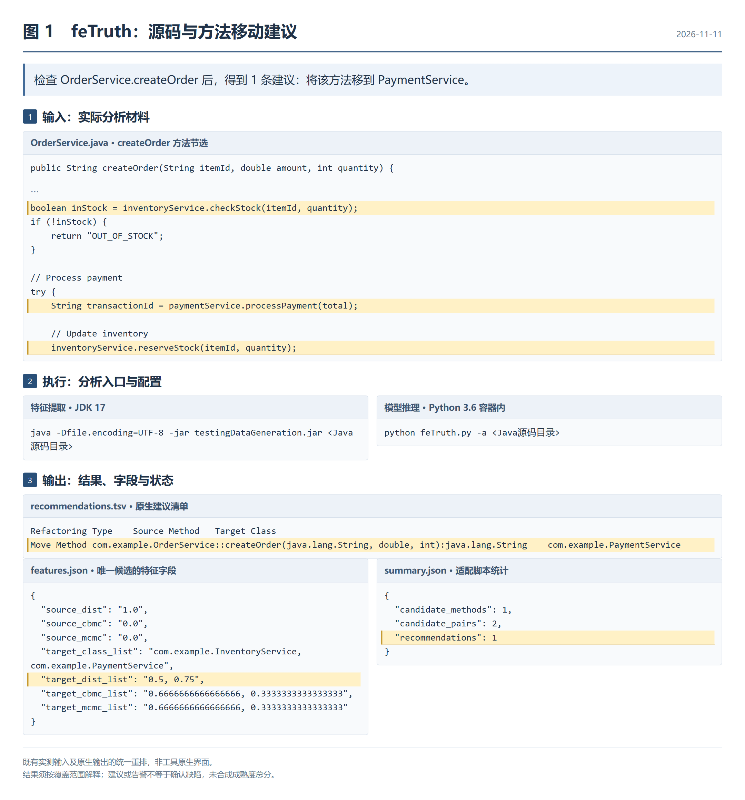

原始文件：[特征 JSON](results/fetruth-project/20261111-141246-910830/features.json)、[建议 TSV](results/fetruth-project/20261111-141246-910830/recommendations.tsv)、[运行汇总](results/fetruth-project/20261111-141246-910830/summary.json)。图中的 `target_*_list` 按 `target_class_list` 顺序一一对应；不能把不同候选类的特征拼在一起。

### 2.2 论文重放与新源码分析

| 流程 | 输入和模型 | 结果 | 含义 |
| --- | --- | --- | --- |
| 论文归档重放 | v1.0.0 归档特征与模型 | 16 条，16/16 与归档结果一致 | 复现该归档输入的输出 |
| jsoup 新源码 | 重新提取 204 个方法、300 个候选关系；源码工作流模型 | 180 条候选 | 新源码功能运行，不是确认了 180 个缺陷 |
| 项目 Java 示例 | 1 个方法、2 个候选关系 | 1 条候选 | 源码入口能用于另一项目样例 |

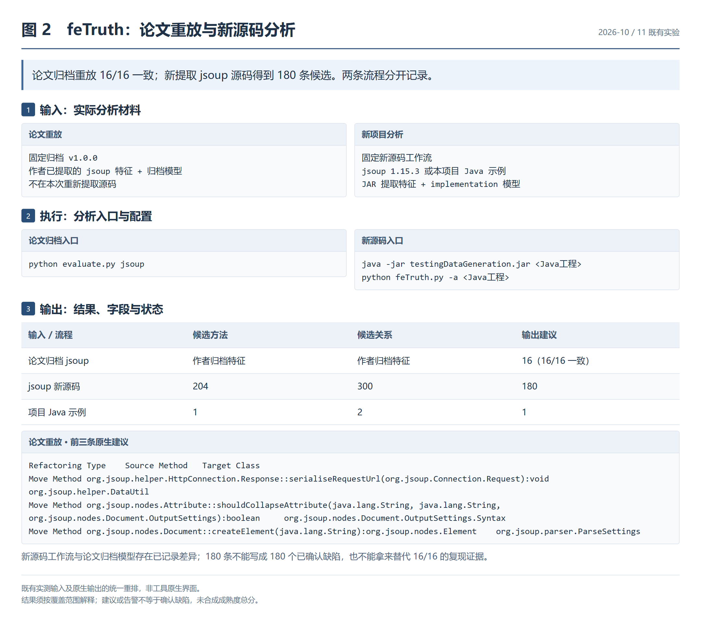

[论文对照](results/fetruth-paper/comparison.json)、[论文原生输出](results/fetruth-paper/jsoup.txt)、[新源码执行记录](results/fetruth/execution.json)、[新源码原生输出](results/fetruth/jsoup.txt)。[模型差异诊断](results/fetruth-model-diagnostics.json)记录了源码工作流模型与归档的差异，不能混用模型与输入后仍声称精确复现论文。

### 2.3 全部输入输出类型

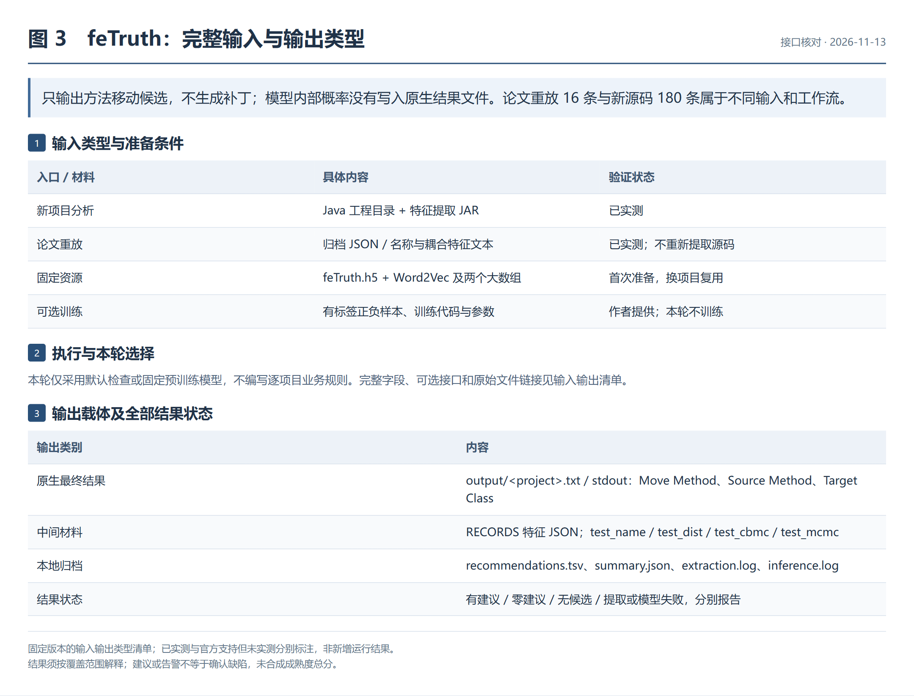

原生最终文件只有重构类型、源方法、目标类三列；概率分数属于模型内部计算，没有写入该文件。零建议、无候选、提取失败和模型加载失败必须分别说明。完整字段和安装条件见[输入输出清单](docs/基线输入输出清单.md)。

## 3. Infer/Pulse：源码错误与路径证据

Infer 捕获正常编译过程形成中间表示；Pulse 跟踪程序路径中的值和内存状态，使用函数摘要进行跨函数分析。本轮固定 1.3.0 并只启用 Pulse，不把其他 Infer 检查器的能力算入本基线。

### 3.1 空指针输入与修改对照

受控 Java 样例将 `null` 传给调用 `length()` 的方法。原生报告给出 `NULLPTR_DEREFERENCE`、文件行号和四步错误路径。增加空值处理后，同一分析器输出空数组；前后均捕获 1 个 Java 文件。

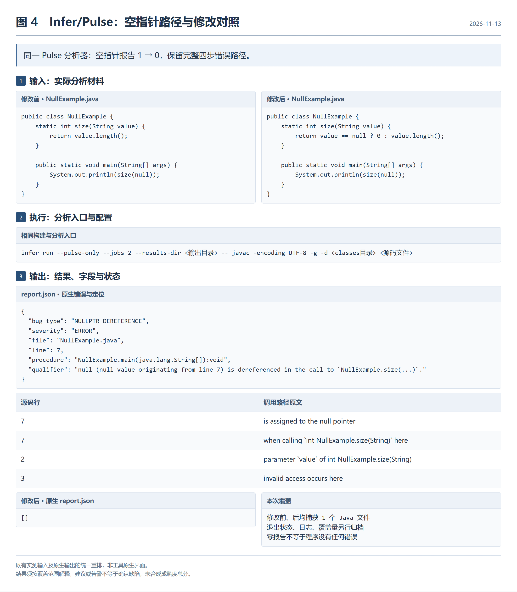

原始文件：[修改前 JSON](results/academic-20261113/infer/before/infer-out/report.json)、[修改后 JSON](results/academic-20261113/infer/after/infer-out/report.json)、[修改前源码](baselines/infer/fixtures/before/NullExample.java)、[修改后源码](baselines/infer/fixtures/after/NullExample.java)。

### 3.2 跨项目输入与报告内容

jsoup、Commons CLI、本项目 Java 示例分别捕获 75、23、4 个 Java 文件，报告 6、0、0 条。jsoup 的 6 条均为 `PULSE_RESOURCE_LEAK`，尚未逐条确认，其中涉及 StringReader 等对象，需要核对资源语义。

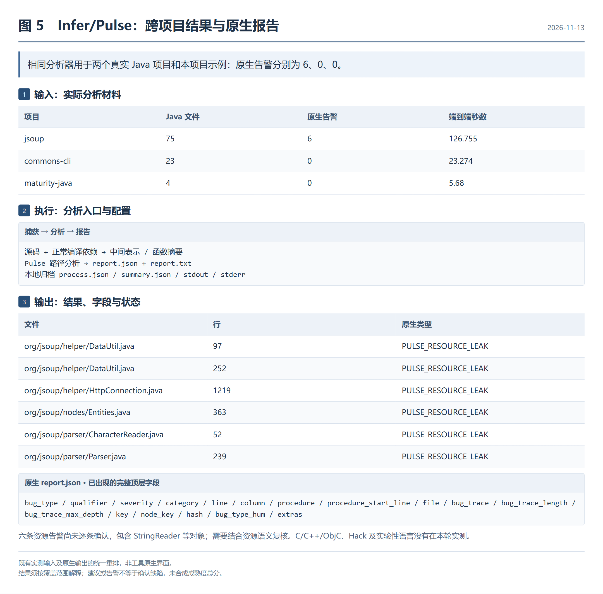

[运行汇总](results/academic-20261113/infer/summary.json)、[jsoup 原生文本](results/academic-20261113/infer/jsoup/infer-out/report.txt)。无告警只表示在本次捕获与分析范围内未报告，编译失败、零捕获和不支持语言均不能算作通过。

## 4. AppCAT：迁移问题、依赖与报告

### 4.1 Java 源码与规则命中

同一 Maven Java 工程将本地文件日志改为标准输出。扫描均以 `azure-aks` 为迁移目标，使用内置规则；不需要 Azure 资源。`local-storage-00001` 从 1 次命中变为 0 次，总命中次数 7→5。

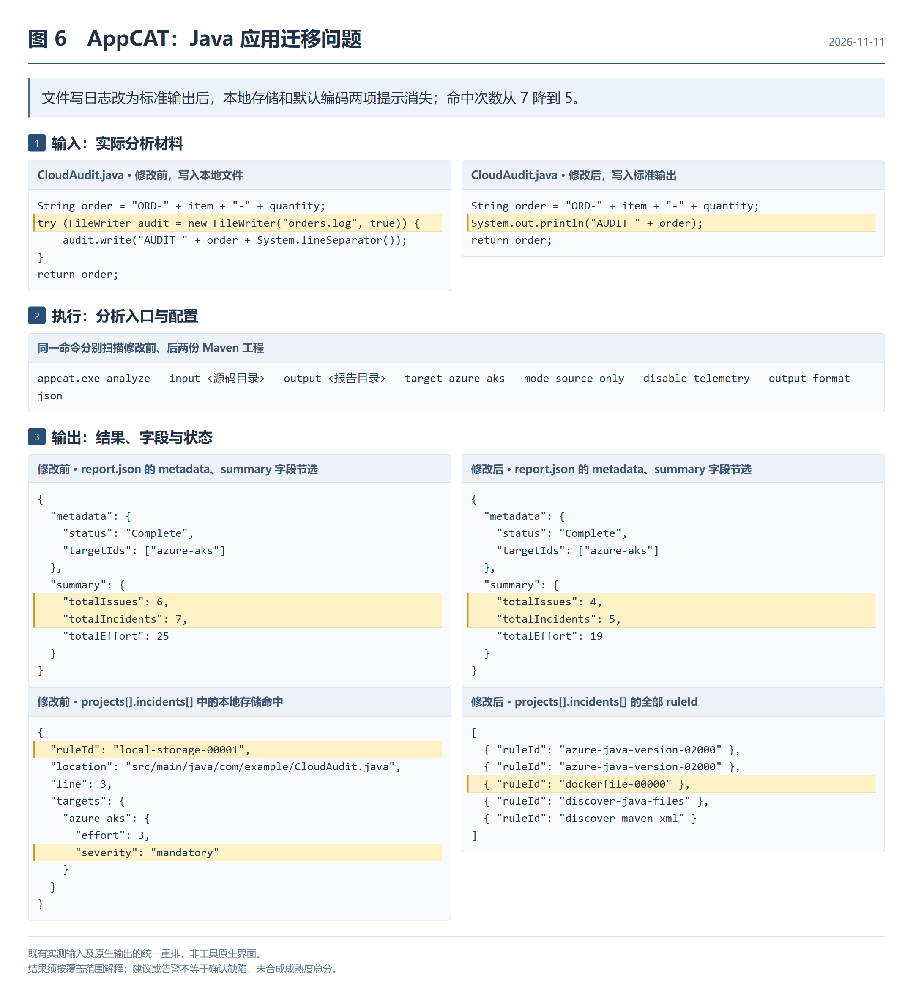

### 4.2 规则详情、依赖和 YAML

原生报告包含问题解释、建议、严重程度、工作量估计、源码位置和片段。`full` 模式额外解析依赖；现有实验另存 JSON、YAML 和静态 HTML。业务检查是本地对照测试，不是 AppCAT 自带的业务判定。

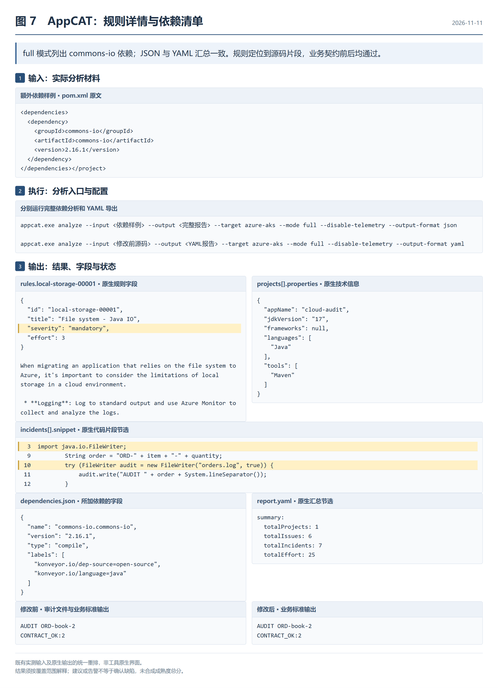

原始文件：[修改前 JSON](results/output-audit/20261111/appcat/before/report.json)、[修改后 JSON](results/output-audit/20261111/appcat/after/report.json)、[依赖 JSON](results/output-audit/20261111/appcat-full/dependencies.json)、[YAML](results/output-audit/20261111/appcat-yaml/report.yaml)。

### 4.3 图 8：直观的前后对照

图 8 与其他截图使用同一模板，展示实际问题和前后变化。去重迁移问题 4→2；前后另有各 2 类技术发现信息，所以原生 `totalIssues` 为 6→4。工作量是工具估计，不是实际工时。原生 HTML 仍可单独查阅，[原生 UI 截图](docs/assets/baseline-outputs/appcat-native.png)保留原貌，不混入统一排版图集。

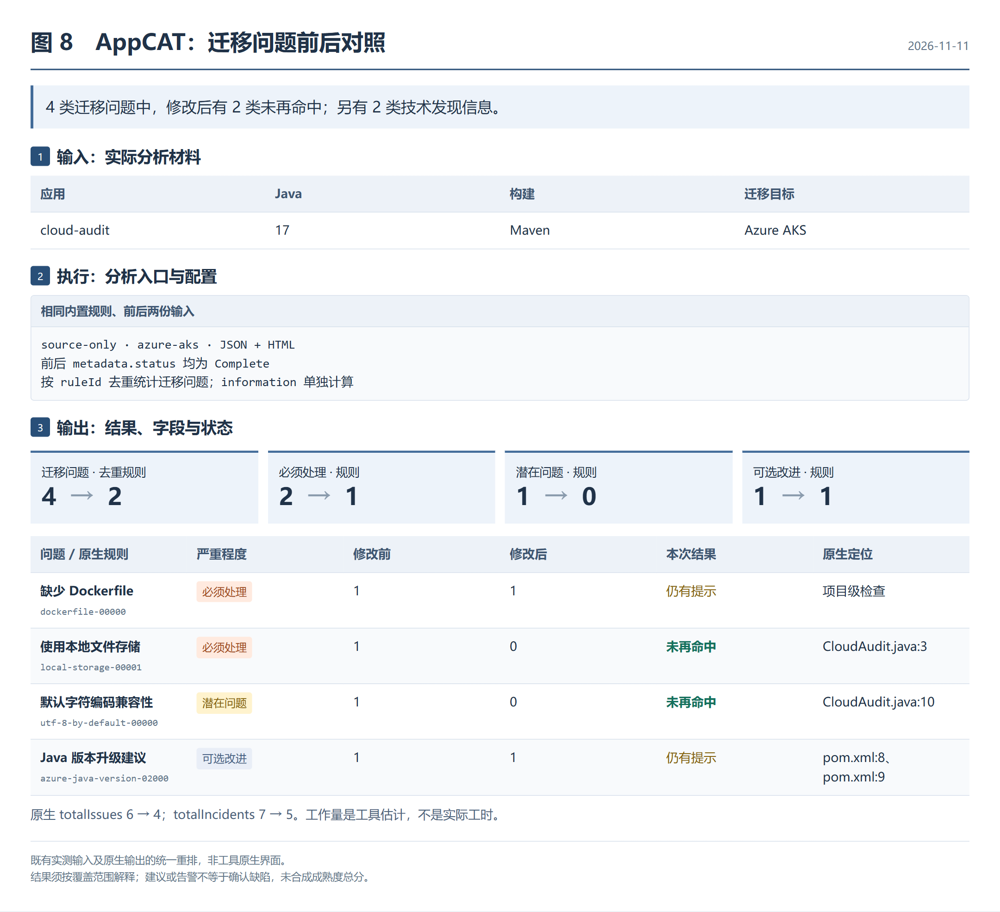

## 5. NeuVector：实际部署与运行风险

### 5.1 运行身份与特权

配置 `runAsUser` 从 0 改为 1000，实际容器 UID 同步改变，API `run_as_root` 由 true 变为 false；两次 HTTP 均返回 `200 + maturity-ok`。Deployment YAML 是建立实验对象的配置，平台真正检查的是实际容器。

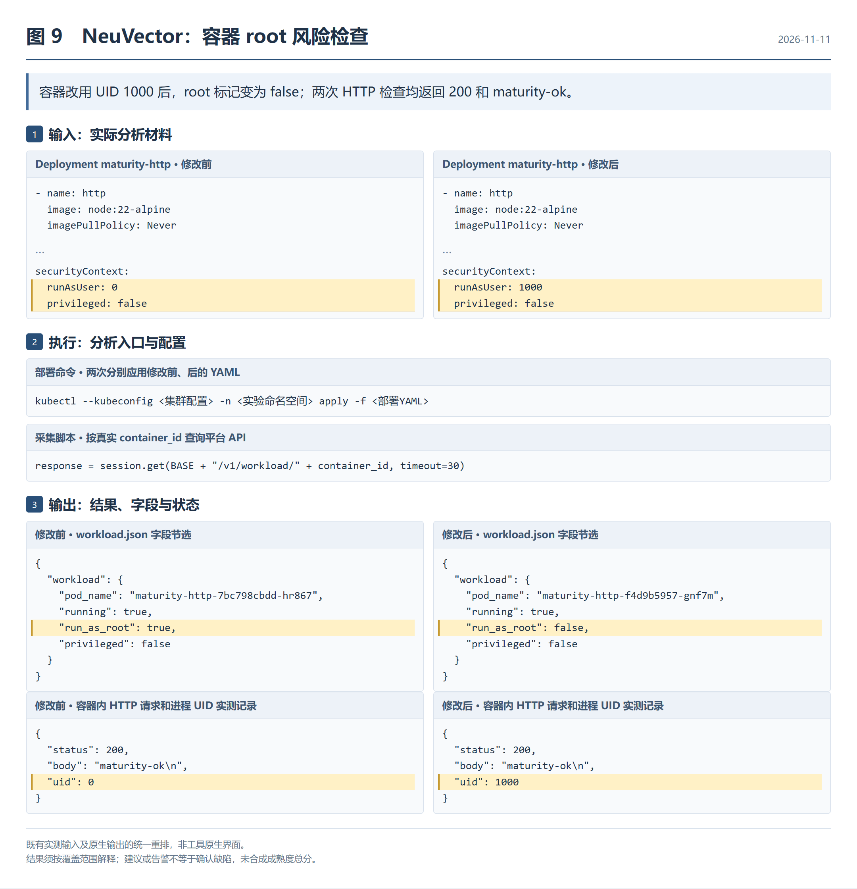

三组权限实验分别为普通 root、特权 root、非 root。首次特权测试平台字段与配置不一致，重新部署后才一致；两次记录保留，不删除失败证据。

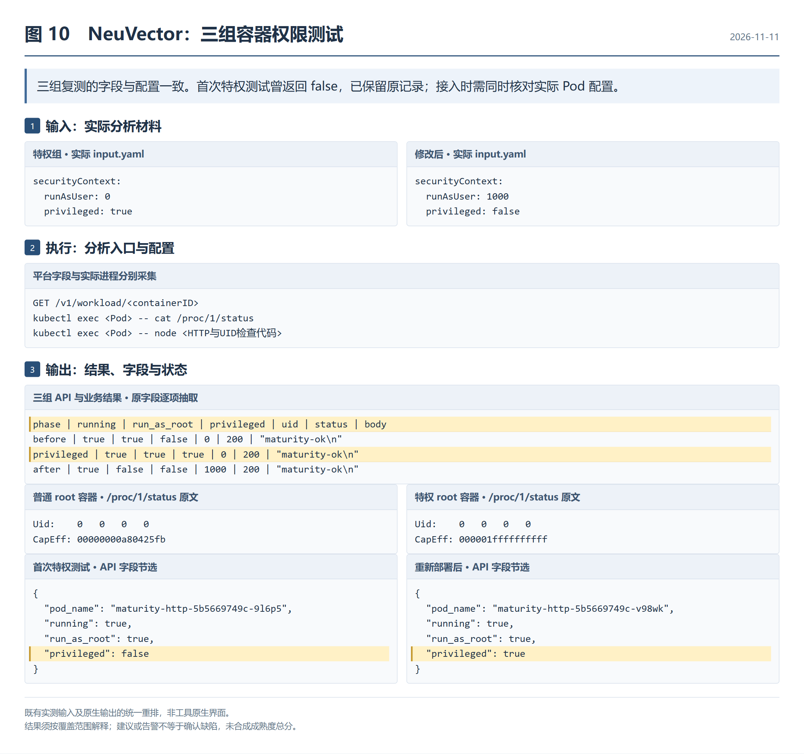

### 5.2 进程、资源、网络和风险分项

按真实容器 ID 读取进程、历史、资源统计、配置和扫描状态。该阶段的全局风险分数为 48，统计整个集群；当时尚未启用漏洞扫描，所以空列表和空扫描时间不代表无漏洞。

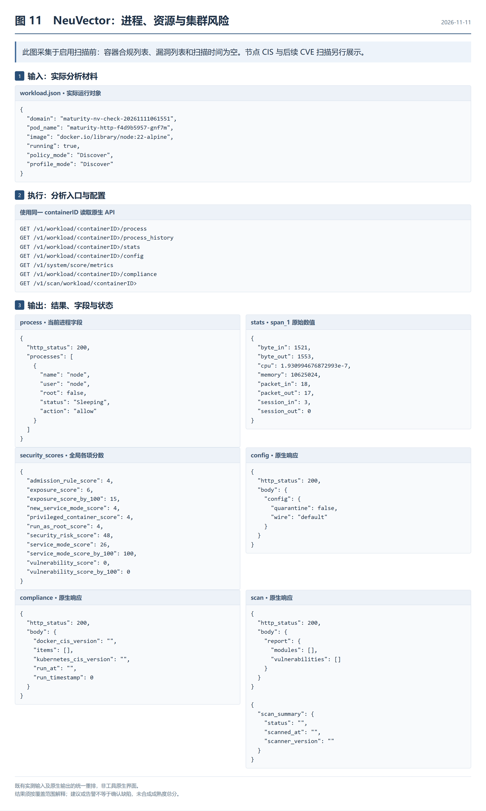

### 5.3 合规与漏洞

节点 CIS 1.8.0 报告共 130 项：52 PASS、38 WARN、40 MANUAL，每项保留编号、说明及修复建议。

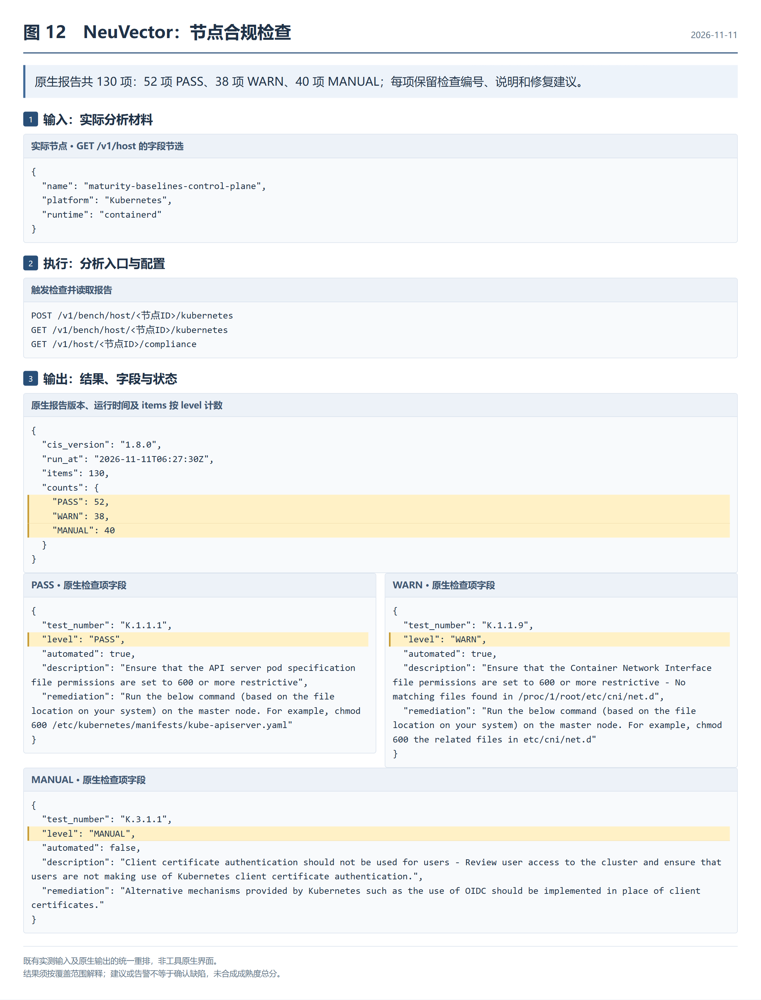

后续对 `node:22-alpine` 容器扫描，返回 27 条漏洞（12 High、15 Medium）及 209 个软件包。报告包含当前版本、修复版本和 CVSS；这些是该次漏洞库和镜像版本下的结果。

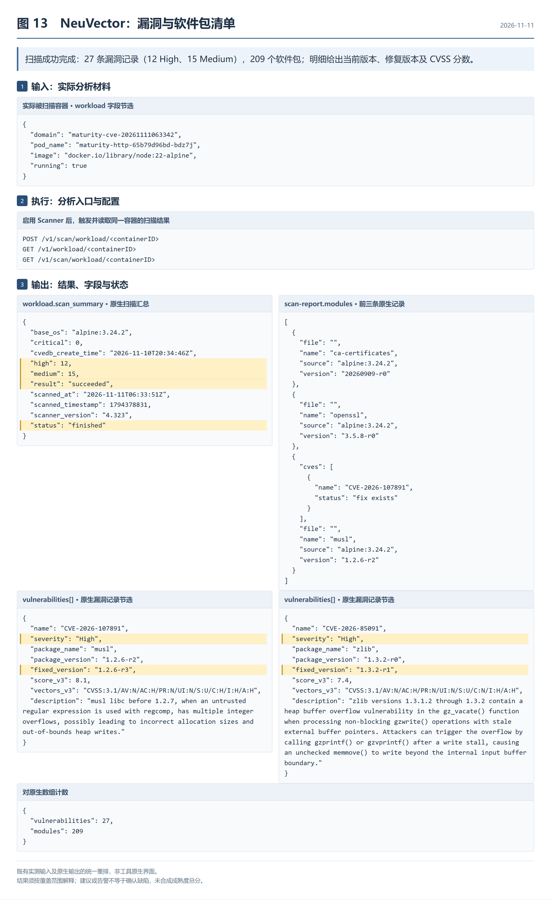

原始目录：[权限与运行数据](results/output-audit/20261111/neuvector-complete)、[CIS 与漏洞](results/output-audit/20261111/neuvector-scanning)。

## 6. 其余完整接口清单

以下是接口清单，不是额外执行成功的实验截图。Infer 的官方目录还包括其他语言相关问题类型，AppCAT 的本机模式包括 `issue-only`，NeuVector 还提供镜像仓库、CI、事件和策略接口。

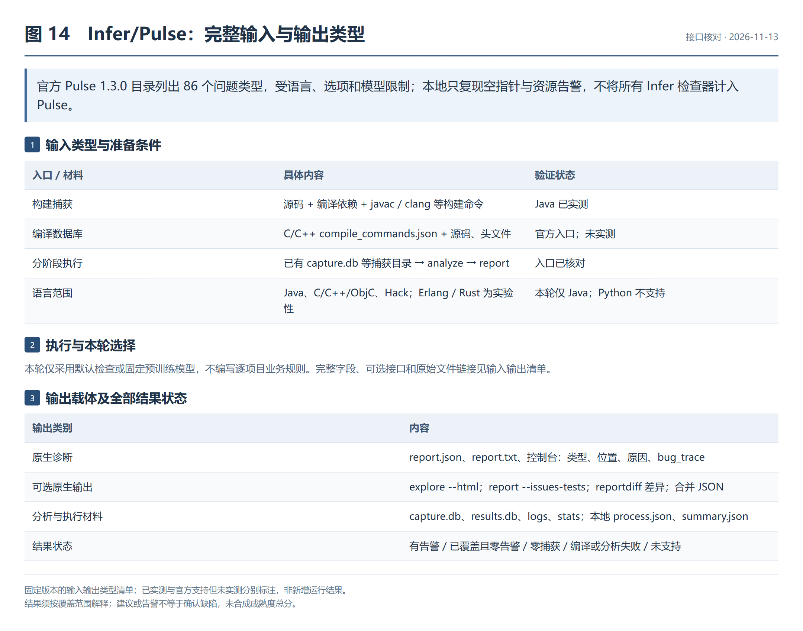

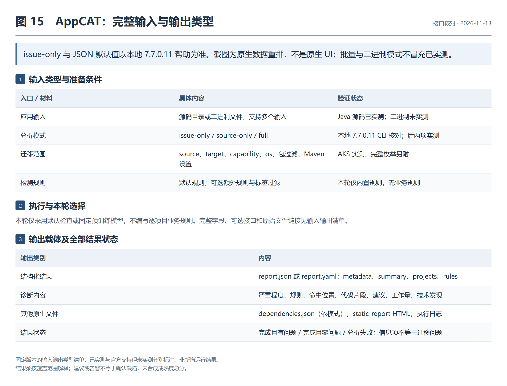

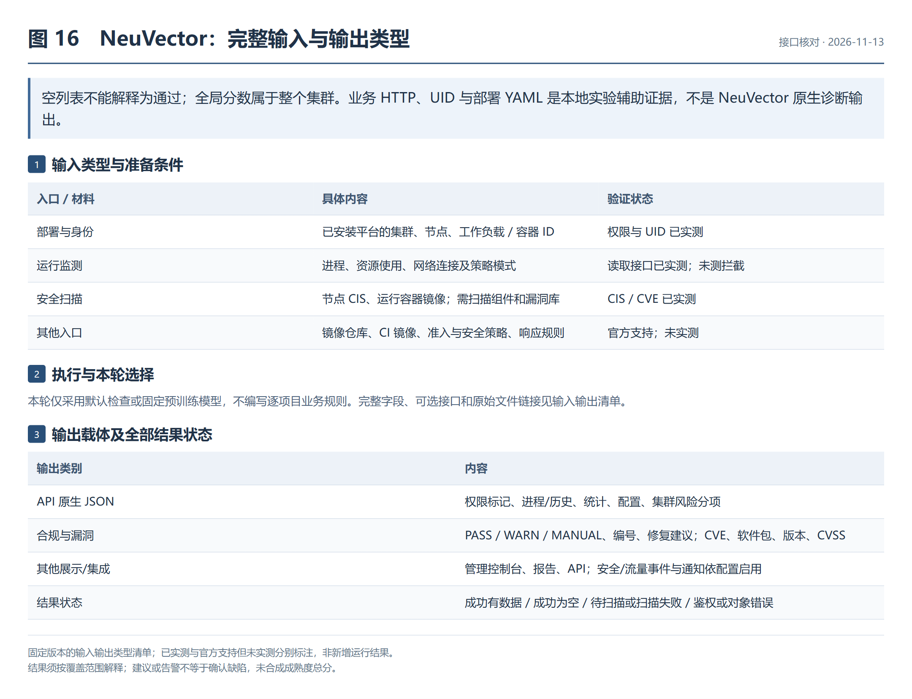

各项字段、完整枚举、结果状态和正式资料见[输入输出清单](docs/基线输入输出清单.md)。

## 7. 复现与接入

学术命令见[Infer + feTruth 复现指南](docs/两项学术基线复现.md)，商用命令见[商用复现指南](docs/两项商用基线复现.md)。本次改动为选型文档、接口归档及截图展示，复用有效的原生实验，没有重新训练或重新扫描业务项目。

现有图谱读取器分别支持四项工具的证据导入；本次未重新合并执行新的“四项联合前后实验”，不沿用旧 GLITCH/Kivi/Reynard 图谱数字冒充当前组合。建议、告警、合规状态和风险指标保留原始含义，不相加成统一分数。
