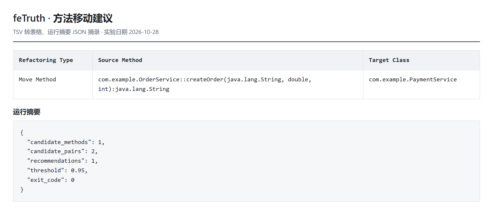
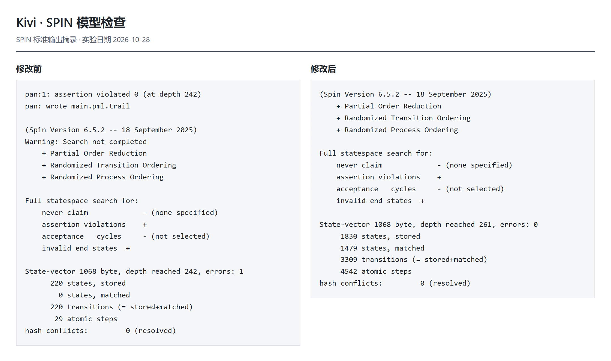
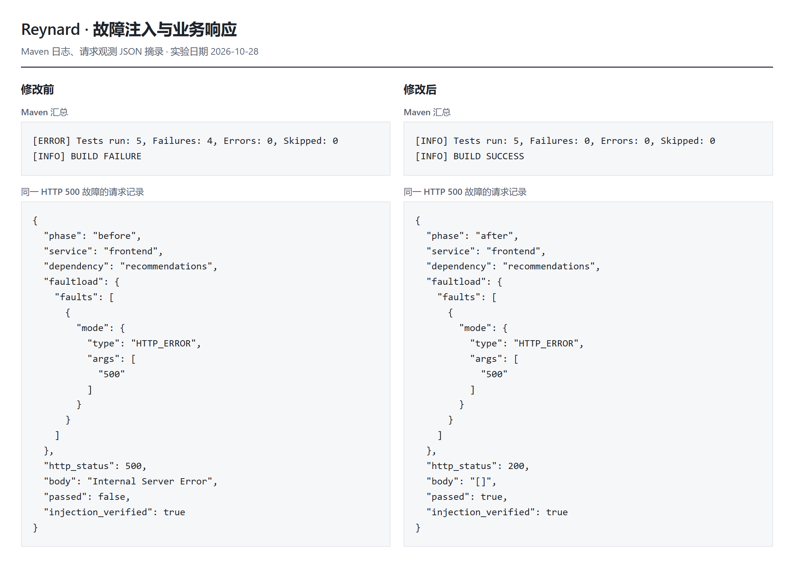
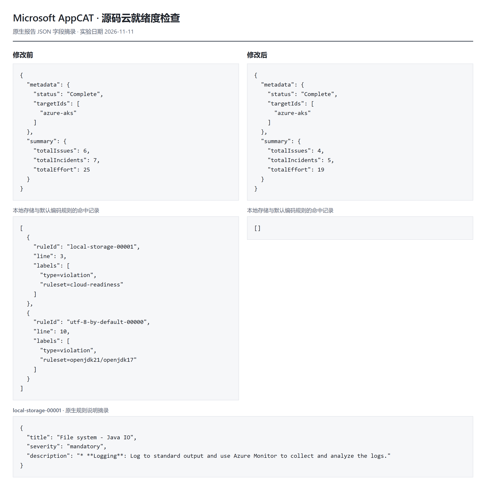
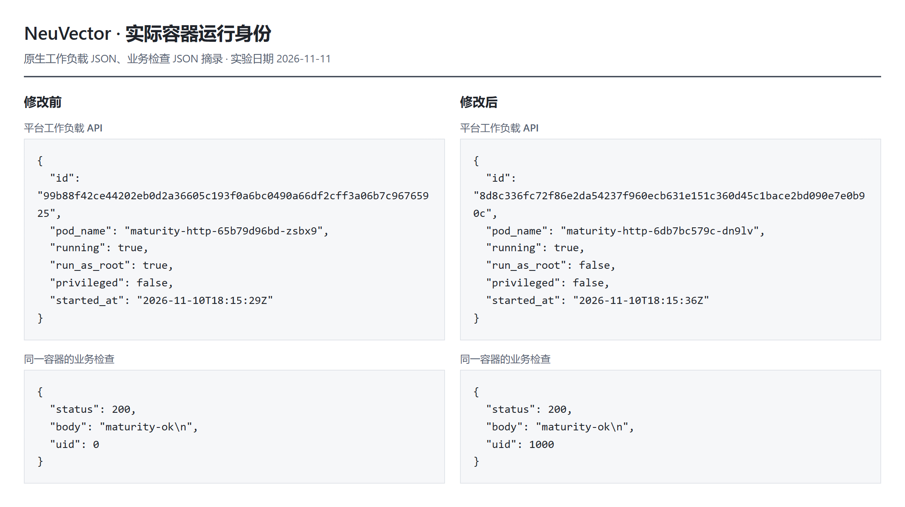

# 成熟度评估 baseline 调研结果

更新：2026-11-11

## 1 方案选择

选用 feTruth、Kivi、Reynard、Microsoft AppCAT for Java 和 SUSE Security／NeuVector。源码评估采用 feTruth、AppCAT；实际部署评估采用 NeuVector；Kivi 和 Reynard 分别检查配置模型与故障下的业务行为。

| 方案 | 输入 | 输出内容 | 核心机制 | 选择理由 |
| --- | --- | --- | --- | --- |
| feTruth | Java 源码 | 方法移动建议（TSV）；候选方法、目标类、耦合特征和覆盖统计（JSON） | 名称词向量与结构耦合特征识别 Feature Envy 异味 | 将类依赖落实到方法职责和移动建议 |
| Kivi | Kubernetes 配置模型及待验证性质 | 性质结果、反例路径、搜索状态数和配置差异（JSON、日志） | Promela 建模，SPIN 搜索反例 | 检查调度、扩容约束的组合问题 |
| Reynard | 微服务、请求、故障设置和业务断言 | 实际故障、调用轨迹、业务响应、断言结果（JSON）；测试汇总（JUnit XML） | 代理注入故障，检查响应；SER 减少重复探索 | 验证服务降级和修改后的业务行为 |
| Microsoft AppCAT for Java | Java 源码及 Maven 工程描述 | 规则 ID、源码位置、严重程度、修改建议、工作量和命中汇总（JSON） | 按目标云平台规则分析源码与技术使用 | 提供工业云就绪度规则，可在本地完成前后对照 |
| SUSE Security／NeuVector | 实际 Kubernetes 工作负载与容器状态 | 容器及 Pod 定位、运行身份风险、运行状态、全局风险分数（JSON） | Enforcer 采集，Controller 汇总，API 输出 | 为源码和模型分析补充真实部署证据 |

## 2 来源、部署与版本

| 方案 | 权威来源 |
| --- | --- |
| feTruth | ESEC/FSE 2023 Research Papers；DOI：10.1145/3611643.3616353；作者仓库 feTruth（lyoubo），1 star |
| Kivi | USENIX ATC 2024，509–527 页；作者仓库 Kivi（bingzheliu），23 stars |
| Reynard | ICSE 2026 Research Track；DOI：10.1145/3744916.3773193；作者仓库 reynard（reynard-testing），4 stars |
| AppCAT | 微软 Azure Migrate 官方工具，7.x 于 2025 年 7 月正式发布；基于 Konveyor 组件，免费使用 |
| NeuVector | SUSE 容器安全产品及开源实现；本次复现采用 NeuVector 开源发行版，软件使用费为 0 |

Star 数采集于 2026-10-29。商业产品依据为 Microsoft Learn《Overview of Azure Migrate application and code assessment for Java》《CLI command guide for AppCAT 7》，以及 SUSE Security 5.6《Installation》。

实验环境：Windows、Python 3.13、JDK 17、Maven 3.9.16、Docker Desktop Linux engine 29.3.1、kind 0.27.0、Kubernetes 1.32.2、Helm 3.19.0。feTruth 的推理依赖单独放在 Python 3.6 容器中。

| 材料 | 固定版本 |
| --- | --- |
| maturity-evaluate | 提交 `116706ac26e17e782374c5b5229a93aef6bfa13f` |
| feTruth | 源码流程提交 `b4f8d5c4fbf655e5615246f2849ccc3825db8e7d`；论文归档 v1.0.0 |
| Kivi | 提交 `81e6c253573b0cc41727885948c1240892d1a6e2` |
| SPIN | 提交 `090f74209025a53297990ec17deca1bd51cb92a5` |
| Reynard | v0.2.2-artifact，提交 `7fc79c85f5eefd766946a6d878abd441f7641f81` |
| AppCAT | Windows amd64 CLI 7.7.0.11 |
| NeuVector | Controller、Enforcer、Manager 镜像均为 5.6.4；Chart 2.8.13，提交 `c2dd1543957c1d6ba244da36a6d06f7ab90e50ab` |

项目部署：创建 Python 虚拟环境，安装 `integration-requirements.lock` 中的依赖和固定版本 maturity-evaluate；按下节准备各工具并执行实验；通过 `build_baseline_graph.py` 导入已有读取器支持的结果，使用 `compare_baseline_graphs.py` 比较前后图谱。

## 3 各方案复现与输出

截图展示已归档实验的 TSV、日志和 JSON 摘录，按原始字段排版。

### 3.1 feTruth

1. 获取固定源码、作者模型及词向量，准备索引和两个约 485 MB 的数组文件。
2. 在 Python 3.6 容器中安装 TensorFlow 2.4.0、Keras 2.4.3 等固定依赖。
3. 用 `replay_fetruth_artifact.py` 重放作者 jsoup 特征；用 `run_fetruth_project.py` 的 `--source` 参数输入项目 Java 源码，完成特征提取和推理。

输出为 TSV 建议清单及 JSON 特征、运行摘要。

| 输出 | 字段 | 含义 |
| --- | --- | --- |
| 方法移动建议 | `Refactoring Type`、`Source Method`、`Target Class` | 重构类型、完整源方法签名、建议迁入的类 |
| 候选特征 | `source_class_name`、`method_signature`、`target_class_list` 及耦合特征 | 参与推理的方法、候选类及结构关系 |
| 覆盖统计 | `candidate_methods`、`candidate_pairs`、`recommendations` | 候选方法数、方法与目标类组合数、建议数 |
| 运行记录 | 源码与工具提交、模型摘要、阈值、执行时间 | 核对输入、模型和运行条件 |

项目样例产生 1 条 `Move Method` 建议：将 `com.example.OrderService` 的 `createOrder(java.lang.String, double, int):java.lang.String` 移入 `com.example.PaymentService`。本次覆盖 1 个候选方法、2 个候选组合。论文归档重放的 16 条建议与作者记录一致，两组实验分别使用各自固定模型。

### 3.2 Kivi

1. 获取固定版本 Kivi 和 SPIN，在 Linux 容器中构建验证镜像。
2. 执行 `run_kivi.py`，依次运行作者违规模型、作者对照模型和修改前后模型。
3. 保存输入模型、SPIN 输出、反例记录及配置补丁。

| 输出 | 字段或记录 | 含义 |
| --- | --- | --- |
| 检查对象与性质 | 资源身份、`intent` | 定位部署模型及待验证性质；本例为 Pod 始终可调度 |
| 性质结果 | `status`、`spin_errors` | `fail` 表示发现反例；`pass` 表示模型搜索完成且无反例 |
| 搜索过程 | `stored_states`、反例记录 | 保存的状态数，以及触发失败的状态和动作顺序 |
| 输入与修改 | 节点及 Pod 分布、调度约束、配置补丁 | 复查约束变化如何影响验证结果 |
| 验证范围 | `scope`、工具提交、日志 | 本例为固定拓扑模型，摘要为 JSON，模型为 Promela |

样例有三个节点，分属两个 zone。Pod 从 5 个扩到 6 个时，节点和 zone 的 `maxSkew=1` 无法同时满足。将 zone 的 `maxSkew` 改为 2 后，节点可分布为 2、2、2，两个 zone 分别为 4、2。

| 组别 | 性质结果 | SPIN errors | 搜索状态数 |
| --- | --- | --- | --- |
| 作者违规模型 | fail | 1 | 207 |
| 作者对照模型 | pass | 0 | 669 |
| 修改前 | fail | 1 | 220 |
| 修改后 | pass | 0 | 1,830 |

### 3.3 Reynard

1. 获取固定源码，应用启动顺序和 npm ci 补丁，构建 Controller、Proxy 镜像及 Java 工程。
2. 定义健康响应和故障下允许的响应，用 `run_reynard_contract.py` 执行修改前后实验。
3. 固定请求、故障集合和断言，保存每次请求的 JSON 记录与 JUnit XML。SER 对照使用同一场景，分别开启和关闭 SER。

| 输出 | 字段 | 含义 |
| --- | --- | --- |
| 场景与依赖 | `scenario`、`phase`、`service`、`dependency` | 业务场景、实验阶段、入口服务和故障依赖 |
| 调用轨迹 | `trace_id`、`span_id`、调用栈 | 关联入口请求、下游调用和返回结果 |
| 故障设置与执行 | `faultload`、`fault_count`、`injected_fault` | 注入类型、参数、数量及代理实际执行的故障 |
| 业务响应 | `http_status`、`body`、`passed` | 状态码、响应体及业务断言结果 |
| 测试汇总 | `tests`、`failures`、`errors`、`skipped` | 执行数、断言失败数、测试异常数、跳过数 |

场景为 `frontend → recommendations`。健康请求返回 `200 + ["product-1"]`；下游分别返回 HTTP 500、502、503、504 时，入口预期返回 `200 + []`。

| 检查 | 修改前 | 启用空列表降级后 |
| --- | --- | --- |
| 健康请求 | 200，商品列表，断言通过 | 同左 |
| 四种下游错误 | 入口返回 500，4 次断言失败 | 入口返回 200、空列表，4 次断言通过 |
| tests / failures / errors / skipped | 5 / 4 / 0 / 0 | 5 / 0 / 0 / 0 |

四种错误响应检查的是同一个降级问题。另在作者 patterns 场景中，SER 将执行次数从 1,849 降为 543。

### 3.4 Microsoft AppCAT for Java

1. 安装官方 CLI 7.7.0.11 和 JDK 17，准备两份含 POM 的 Maven Java 工程。
2. 使用 `appcat analyze`，由 `--input`、`--output` 指定输入和结果位置；固定参数为 `--target azure-aks --mode source-only --disable-telemetry --output-format json`，启用默认规则。
3. 将审计日志从 `FileWriter` 写本地文件改为标准输出，重新扫描，并验证订单结果、非法数量拒绝行为和审计文本。项目脚本 `reproduce_appcat.ps1` 执行两个阶段，`verify_appcat.py` 检查结果。

输出包括原生 JSON 和 HTML 报告。

| 输出 | 字段 | 含义 |
| --- | --- | --- |
| 分析状态与目标 | `metadata.status`、`targetIds`、起止时间 | 分析是否完成、目标平台及执行时间 |
| 规则说明 | `rules` 中的 `id`、`title`、`description` | 检查项、问题说明和修改建议 |
| 命中位置 | `ruleId`、`incidentId`、`location`、`line`、`snippet` | 规则、命中实例、文件、行号和代码片段 |
| 分类与工作量 | `severity`、`labels`、`effort` | 必须、可选、潜在或信息项，以及修改工作量估计 |
| 汇总 | `totalIssues`、`totalIncidents`、`totalEffort` | 规则项数、命中实例数和工作量；规则项包含技术发现信息 |

| 检查 | 修改前 | 修改后 |
| --- | --- | --- |
| 原生报告状态 | Complete | Complete |
| 本地存储规则 `local-storage-00001` 命中 | 1 | 0 |
| 默认编码规则 `utf-8-by-default-00000` 命中 | 1 | 0 |
| totalIssues / totalIncidents | 6 / 7 | 4 / 5 |
| `type=violation` 实例数 | 5 | 3 |
| 订单结果、非法数量两项契约 | 2/2 通过 | 2/2 通过 |
| 审计文本 | `AUDIT ORD-book-2`，写入文件 | 同文，写入标准输出 |

移除同一处 `FileWriter` 后，本地存储和默认编码两项提示同时消失。剩余提示为 Java 版本和 Dockerfile。实验覆盖本地源码扫描及业务检查。

### 3.5 SUSE Security／NeuVector

1. 准备 kind 集群，通过官方 Helm Chart 部署 Controller、Enforcer、Manager，三者镜像均指定为 5.6.4。实验使用单节点，CVE Scanner、Updater 关闭。
2. 设置本地平台管理员密码，通过端口转发访问 Controller API，并取得登录会话。
3. 在独立命名空间部署 HTTP 服务，用实际 Pod 的 `containerID` 查询工作负载 API；同时读取容器 UID 和 HTTP 响应。
4. 将 `securityContext.runAsUser` 从 0 改为 1000，保持镜像和业务代码一致，重复采集。项目脚本 `reproduce_neuvector.py` 完成部署、采集和比较。

输出为平台工作负载 JSON、部署快照和业务检查记录。

| 输出 | 字段或记录 | 含义 |
| --- | --- | --- |
| 对象身份 | `id`、`domain`、`pod_name`、Pod UID 标签 | 实际容器、命名空间和 Pod，绑定平台与集群对象 |
| 镜像身份 | `image`、`image_id` | 镜像名称及内容身份，核对前后所用镜像 |
| 运行风险 | `run_as_root`、`privileged` | 是否以 root 运行、是否为特权容器 |
| 运行状态 | `running`、`started_at` | 容器是否运行及启动时间 |
| 业务检查 | 实际 UID、HTTP 状态码与响应体 | 核对进程身份和服务行为 |
| 平台概览 | `security_risk_score` | 全局风险分数，与目标容器字段分别记录 |

| 检查 | 修改前 | 修改后 |
| --- | --- | --- |
| 原生 running | true | true |
| 原生 run_as_root | true | false |
| 实际进程 UID | 0 | 1000 |
| HTTP 状态及响应 | 200，`maturity-ok` | 同左 |
| 原生 privileged | false | false |
| 全局 security_risk_score | 44 | 44 |

本次完成真实容器的运行身份风险对照，业务响应保持一致，全局分数维持 44。

## 4 项目接入与进度

各方案保留对象、检查项、结果、来源和时间，按源码、模型、运行行为与部署风险分别比较。

| 来源 | 对象绑定 | 当前进度 |
| --- | --- | --- |
| feTruth | 类节点及方法签名 | 已接入图谱；得到方法移动候选 |
| Kivi | Deployment 模型及待验证性质 | 已接入图谱；完成固定模型前后验证 |
| Reynard | Service、调用关系、故障场景 | 已接入图谱；完成示例服务前后验证 |
| AppCAT | 源码版本、规则 ID、文件及位置 | 已归档原生报告与业务检查；待实现读取器 |
| NeuVector | 集群、命名空间、Pod UID、容器 ID | 已归档运行风险与业务检查；待实现读取器 |

三项学术实验的前后图谱各有 13 个节点、9 条边；比较得到 5 条检查转为通过，分别为 Kivi 的一条性质和 Reynard 的四种错误响应。

后续工作：实现两项商业结果读取器，接入团队 otel-demo，完成真实 K8s 到 Kivi 的映射、方法移动验证，以及 Python、FaaS、CIS 合规和 CVE 漏洞专项实验。
